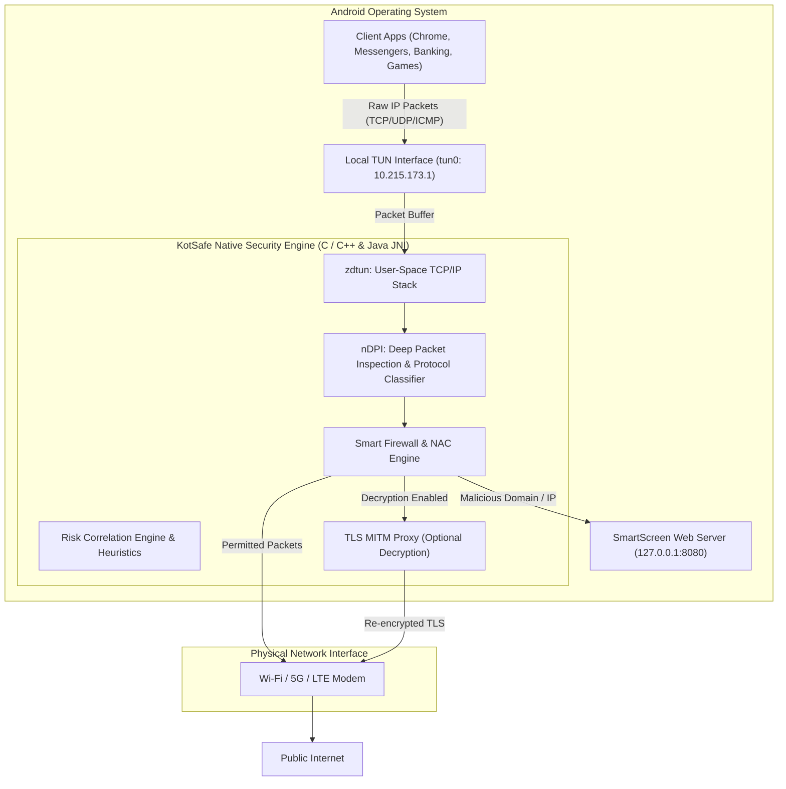

# Chapter 1: KotSafe Architecture & Initial Setup


[🏠 Table of Contents](README.md) | [🎨 Frontend Architecture](FRONTEND_ARCHITECTURE.md) | [➡️ Chapter 2: Smart Firewall & NAC](02_FIREWALL_AND_NETWORK_ACCESS_CONTROL.md)

---

KotSafe is engineered to provide complete packet inspection, application-level firewall control, and real-time malware defense on modern Android operating systems **without requiring root privileges**. This chapter covers the internal mechanics of the non-root VPN simulation, the underlying packet processing pipeline, required permissions, and step-by-step setup procedures.

---

## 1. How KotSafe Works (Core Architecture)

On stock Android systems, security sandbox barriers prevent standard applications from monitoring or intercepting network packets generated by other applications. KotSafe overcomes this limitation by utilizing Android's native `VpnService` API to establish a local, in-memory virtual network interface.

### Non-Root VPN Simulation & L4 Transparent Proxy



### Core Architecture Highlights

1. **Local Loopback (Zero Remote Servers)**:
   * KotSafe operates strictly on `10.215.173.1` (IPv4) and `fd00::1` (IPv6).
   * **Your network traffic never touches an external proxy server or remote VPN endpoint.** All dissection, filtering, and analysis occur 100% locally on your device hardware.
2. **`zdtun` User-Space TCP/IP Stack**:
   * Packets arriving at the virtual network adapter (`tun0`) are ingested into `zdtun`, a high-performance C library that reassembles TCP streams and translates raw IP packets into standard POSIX sockets.
3. **`nDPI` Deep Packet Inspection**:
   * KotSafe incorporates `nDPI` (an open-source deep packet inspection engine) to classify over 300 application protocols (e.g., TLS SNI, HTTP Host, DNS, BitTorrent, WhatsApp, Telegram, WireGuard).
   * It determines what an app is contacting even **before** TLS decryption takes place, by analyzing the Server Name Indication (SNI) in the initial TLS Client Hello handshake.
4. **UID-to-Package Mapping**:
   * For every packet hitting the TUN interface, KotSafe queries Android's `ConnectivityManager` and `TrafficStats` socket table to map the source Linux User ID (UID) to the exact installed application package name (e.g., `com.whatsapp` or `com.android.chrome`).

---

## 2. Installation & Permissions Setup

KotSafe follows an enterprise security model, requesting permissions dynamically and explaining the exact rationale for each capability.

### Permission Reference Matrix

| Permission Name | System Identifier | Mandatory? | Purpose & Rationale |
| :--- | :--- | :---: | :--- |
| **VPN Service** | `android.net.VpnService` | **Yes** | Mandatory to route device network traffic through KotSafe's local inspection engine. |
| **Notifications** | `POST_NOTIFICATIONS` (Android 13+) | Recommended | Alerts you instantly when threats, phishing links, or unauthorized socket connections are blocked. |
| **All Files Access** | `MANAGE_EXTERNAL_STORAGE` | Recommended | Required by the **File Protection Watcher** and offline AV scanner to inspect downloaded files in `/Download` and messenger storage. |
| **Accessibility Service** | `AccessibilityService` | Optional | Enables **URL Shield**: tracks browser address bars in Chrome, Firefox, Edge, and Brave to enforce SmartScreen phishing protection on raw URLs. |
| **Battery Optimization Exemption** | `REQUEST_IGNORE_BATTERY_OPTIMIZATIONS` | Recommended | Prevents Android's aggressive Doze mode from killing the background monitoring service during screen-off sleep. |

---

## 3. Step-by-Step Setup Guide

### Step 1: Install KotSafe
Install the official KotSafe APK. Ensure the package signature is verified.

### Step 2: Grant Permissions via Setup Wizard
1. Launch **KotSafe**. The initial onboarding screen walks you through required permissions.
2. Tap **Grant Notification Permission** and select **Allow** when prompted.
3. Tap **Storage Permission**:
   * Android will open the **All files access** settings page.
   * Locate **KotSafe** in the list and toggle the switch to **Allow access to manage all files**.
4. Tap **Battery Optimization**:
   * Tap **Allow** on the system dialog prompting to let KotSafe run unrestricted in the background.
5. *(Optional)* Tap **Enable URL Shield**:
   * Tap **Go to Settings** $\rightarrow$ Under **Downloaded apps** / **Accessibility**, tap **KotSafe URL Shield**.
   * Toggle the service to **ON** and accept the system accessibility prompt.

### Power User & Enterprise ADB Quick-Setup
If you are deploying KotSafe across enterprise devices or prefer configuring permissions via Android Debug Bridge (ADB), run:

```bash
# Grant notification permission (Android 13+)
adb shell pm grant com.kotsafe.security android.permission.POST_NOTIFICATIONS

# Whitelist KotSafe from battery optimization (Doze mode)
adb shell dumpsys deviceidle whitelist +com.kotsafe.security

# Grant manage all files access (Android 11+)
adb shell appops set com.kotsafe.security MANAGE_EXTERNAL_STORAGE allow
```

---

## 4. Starting and Managing Your First Capture

Once permissions are configured, you are ready to initiate packet inspection and defense:

```
┌────────────────────────────────────────────────────────┐
│                      KotSafe                           │
│  [Status: READY]                           [Settings]  │
├────────────────────────────────────────────────────────┤
│                                                        │
│                    ┌─────────────┐                     │
│                    │    START    │  Tap to begin       │
│                    │   CAPTURE   │  defense & capture  │
│                    └─────────────┘                     │
│                                                        │
│   Throughput:  0.0 KB/s ▲ | 0.0 KB/s ▼                 │
│   Active Connections: 0   | Blocked Threats: 0         │
└────────────────────────────────────────────────────────┘
```

1. On the main dashboard, tap the large **Start** button.
2. If this is your first time starting, Android presents the standard system dialog:
   > *"KotSafe wants to set up a VPN connection that allows it to monitor network traffic. Only accept if you trust the source."*
3. Tap **OK**. A key icon will appear in your Android status bar, confirming the local VPN interface is running.
4. The dashboard will immediately transition to **ACTIVE (Green)**:
   * **Live Throughput**: Real-time upload and download speeds.
   * **Active Connections Counter**: Number of currently open TCP and UDP sockets.
   * **Threats Blocked**: Real-time counter of connections denied by the firewall or threat intelligence feeds.

> [!NOTE]
> KotSafe's VPN interface runs exclusively on your local device. Because no packets leave your phone for a remote tunnel server, your network latency is virtually unaffected, and your actual external IP address is unchanged.

---

## 5. Navigation Overview

KotSafe's user interface is organized into five primary tabs and an expandable navigation drawer:

* **Dashboard**: Capture controls, live bandwidth telemetry, threat overview, and quick status toggles.
* **Connections**: Real-time connection log detailing every flow (timestamp, app name, protocol, source/destination IP, port, duration, bytes transferred, and status).
* **Firewall**: Master firewall toggle, granular Per-App Network Access Control (NAC), blacklist/whitelist rule editor, and SmartScreen block history.
* **Antivirus**: Real-time radar scan interface, Quick and Full system scans, File Protection Watcher status, and APK Pre-Install Scanner findings.
* **Action Center**: Centralized security console displaying recent security alerts, threat classifications, MITRE ATT&CK tactics, and one-tap remediation actions.

---

[🏠 Table of Contents](README.md) | [➡️ Chapter 2: Smart Firewall & NAC](02_FIREWALL_AND_NETWORK_ACCESS_CONTROL.md)
