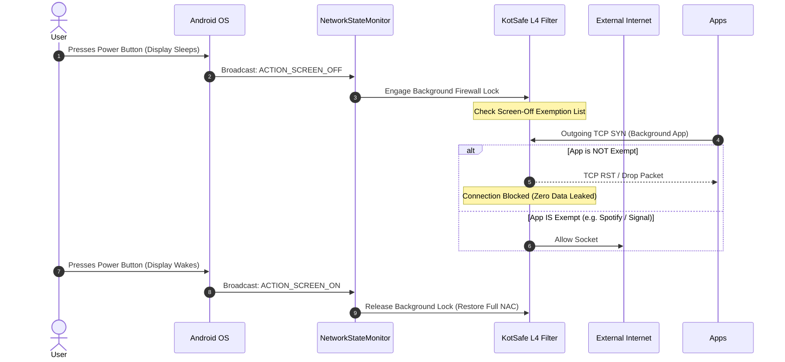

# Chapter 2: Smart Firewall & Network Access Control (NAC)


[⬅️ Chapter 1: Architecture & Setup](01_ARCHITECTURE_AND_SETUP.md) | [🏠 Table of Contents](README.md) | [➡️ Chapter 3: Antivirus & Malware Defense](03_ANTIVIRUS_AND_MALWARE_DEFENSE.md)

---

KotSafe integrates an enterprise-grade **Application Firewall** and multi-dimensional **Network Access Control (NAC)** engine. It gives you total sovereignty over how, when, and through which physical interfaces every app on your Android device is allowed to transmit data.

---

## 1. Enabling the Master Firewall

The firewall operates in real time directly within the local L4 packet pipeline:

1. Open **KotSafe**.
2. Tap the **Firewall** tab on the navigation bar (or open the left navigation drawer $\rightarrow$ **Firewall**).
3. Toggle the **Enable Firewall** master switch to **ON**.
4. Once active, the status pill updates to **FILTERING ACTIVE**. Every packet traversing the `tun0` interface is now evaluated against your security rule sets before being allowed onto the physical network interface.

> [!NOTE]
> When the Master Firewall is OFF, KotSafe operates in passive capture mode (logging packets without blocking). When turned ON, active enforcement is engaged instantly across all running apps without requiring a service restart.

---

## 2. Granular Network Access Control (NAC)

Standard Android app permissions are all-or-nothing (`android.permission.INTERNET`). KotSafe provides five-dimensional granular access control per application:

| NAC Control | Icon | Mechanism & Threat Scenario | Configuration Path |
| :--- | :---: | :--- | :--- |
| **Wi-Fi Block** | 📶 | Cuts all transmission when connected to Wi-Fi. Ideal for preventing untrusted apps from scanning local office/home networks. | Tap the **Wi-Fi** icon next to the target app in the NAC list. |
| **Cellular / 5G Block** | 📱 | Restricts the app from consuming mobile cellular data while permitting unmetered Wi-Fi usage. Perfect for data hogs, video streamers, and cloud backups. | Tap the **Cellular** icon next to the target app. |
| **Data Roaming Block** | ✈️ | Automatically halts all communication when the device switches to an international roaming carrier, eliminating unexpected bill shock. | Tap app row $\rightarrow$ Toggle **Block Roaming Data**. |
| **Screen-Off Traffic Blocker** | 🌙 | Terminates active and pending sockets the moment your phone display locks. Stops background tracking, covert telemetry, and ad refreshes. | Tap app row $\rightarrow$ Toggle **Block when screen is off** (or enable globally). |
| **LAN Access Block** | 🏠 | Isolates the app by blocking communication to private RFC 1918 subnets (`192.168.0.0/16`, `10.0.0.0/8`, `172.16.0.0/12`), while allowing public Internet access. | Tap app row $\rightarrow$ Toggle **Isolate from Local Network (LAN)**. |

---

## 3. Screen-Off Background Traffic Blocker

### The Problem
Commercial apps, ad networks, and spyware continuously wake the cellular radio to transmit background telemetry, upload location pings, and fetch ad banners while your phone sits idle in your pocket. This degrades battery longevity and compromises user privacy.

### KotSafe's Solution (`NetworkStateMonitor`)
KotSafe registers an internal Android broadcast receiver that listens for `ACTION_SCREEN_OFF` and `ACTION_SCREEN_ON` events:



### Configuring Exemptions
To prevent music streaming (Spotify, YouTube Music) or messaging notifications (WhatsApp, Signal) from interrupting:
1. Go to **Firewall Settings** $\rightarrow$ **Screen-Off Exemptions**.
2. Check the box next to critical apps.
3. Exempted apps maintain uninterrupted background connectivity while all other apps remain strictly network-isolated while your screen is locked.

---

## 4. Rule Enforcement Hierarchy

KotSafe resolves connection requests through a strict priority matrix to ensure deterministic behavior and zero false-bypass vulnerabilities:

```
┌─────────────────────────────────────────────────────────────┐
│ 1. Explicit Whitelist Override                              │ ➔ ALLOW
│    (User-defined bypass for IP, domain, or app)             │
├─────────────────────────────────────────────────────────────┤
│ 2. App Network Access Control (NAC) Rules                   │ ➔ BLOCK
│    (Wi-Fi, Cellular, Roaming, Screen-off, LAN block)        │
├─────────────────────────────────────────────────────────────┤
│ 3. Explicit User Blacklist Rules                            │ ➔ BLOCK
│    (Custom blocked domains, IPs, subnets, URL patterns)     │
├─────────────────────────────────────────────────────────────┤
│ 4. Threat Intelligence Cloud Feeds                          │ ➔ BLOCK
│    (VirusTotal, AlienVault OTX, MalwareBazaar matches)      │
├─────────────────────────────────────────────────────────────┤
│ 5. Automated Global Blocklists                              │ ➔ BLOCK
│    (StevenBlack, AdGuard, OISD, Malicious Host feeds)       │
├─────────────────────────────────────────────────────────────┤
│ 6. Default Policy (Whitelist Mode vs Blacklist Mode)        │
│    • Blacklist Mode (Default): ALLOW                        │ ➔ ALLOW
│    • Whitelist Mode (Zero Trust): BLOCK                     │ ➔ BLOCK
└─────────────────────────────────────────────────────────────┘
```

---

## 5. Blacklist Mode vs. Whitelist Mode (Zero Trust)

KotSafe supports two primary operational security postures:

### A. Blacklist Mode (Default / Balanced)
* **Default Action**: Allow traffic.
* Outgoing connections are permitted unless explicitly blocked by NAC rules, user blacklists, threat intelligence feeds, or ad-blocking lists.
* **Recommended For**: Everyday users and normal phone operation.

### B. Whitelist Mode (Zero-Trust Enterprise)
* **Default Action**: Deny all traffic.
* **Every single app is completely cut off from the Internet by default.**
* Only explicitly whitelisted applications and system services (e.g., DNS resolver, Google Play Services if required) are allowed to communicate.
* **Recommended For**: High-security environments, financial transactions, journalists in high-threat locations, or when connected to untrusted public Wi-Fi.

**How to toggle Whitelist Mode**:
* Go to **Firewall** $\rightarrow$ Tap the gear icon **Settings** $\rightarrow$ Toggle **Whitelist Mode (Block by Default)**.

---

## 6. Manual Blocking (IPs, Subnets, Domains, and URLs)

You can create custom firewall rules targeting specific network endpoints:

1. In the **Firewall** tab, tap the floating **"+" (Add Rule)** button.
2. Select the **Target Type**:
   * **Application**: Select any installed app to completely ban it from networking.
   * **Domain / Hostname**: Enter a specific domain (e.g., `telemetry.apptracker.io`) or wildcard (`*.adnetwork.com`).
   * **IP Address / Subnet**: Enter a single IPv4/IPv6 address or CIDR subnet (e.g., `198.51.100.0/24`).
   * **URL Prefix**: Block specific paths (e.g., `http://malicious-site.com/dropper/`).
3. Set **Action**:
   * **BLOCK**: Denies traffic and redirects HTTP connections to SmartScreen.
   * **ALLOW**: Creates an explicit whitelist exemption that bypasses all blocklists.
4. Tap **Save Rule**. Enforcement occurs immediately in memory without connection interruption.

---

## 7. The SmartScreen Browser Block Page

When a browser (Google Chrome, Mozilla Firefox, Microsoft Edge, Brave, Opera, Samsung Internet) attempts to navigate to a blacklisted or malicious domain, KotSafe intercepts the HTTP request and routes it to an internal web server:

```
┌──────────────────────────────────────────────────────────────┐
│  ⚠️ KotSafe SmartScreen Security Alert                       │
├──────────────────────────────────────────────────────────────┤
│  ACCESS BLOCKED: This site has been reported as MALICIOUS    │
│                                                              │
│  Target URL:   http://phishing-banking-portal.com/login      │
│  Category:     Phishing / Credential Theft                   │
│  Threat Feed:  VirusTotal Consensus (28/72 Engines)          │
│  App:          Google Chrome (com.android.chrome)            │
│  Timestamp:    2026-09-14 15:20:12                           │
│                                                              │
│  ┌─────────────────────────┐   ┌──────────────────────────┐  │
│  │     Back to Safety      │   │   Advanced: Unblock Site │  │
│  │       (Recommended)     │   │      (Temporary 1 Hr)    │  │
│  └─────────────────────────┘   └──────────────────────────┘  │
└──────────────────────────────────────────────────────────────┘
```

### Features of the SmartScreen Interception Page:
* **Embedded HTTP Server (`127.0.0.1:8080`)**: Handled entirely within `FirewallBlockHttpServer.java`. No internet traffic is required to render the warning page.
* **Threat Telemetry**: Explains why the site was blocked, citing the exact matching rule or threat intelligence source.
* **Interactive Safe Unblock**:
  * If a legitimate website is blocked by an overzealous blocklist, tap **Advanced $\rightarrow$ Temporarily Allow**.
  * KotSafe offers two unblock durations:
    * **Temporary Bypass (1 Hour)**: Automatically re-engages the block after 60 minutes.
    * **Permanent Whitelist**: Adds the domain to your personal whitelist database.

---

[⬅️ Chapter 1: Architecture & Setup](01_ARCHITECTURE_AND_SETUP.md) | [🏠 Table of Contents](README.md) | [➡️ Chapter 3: Antivirus & Malware Defense](03_ANTIVIRUS_AND_MALWARE_DEFENSE.md)
