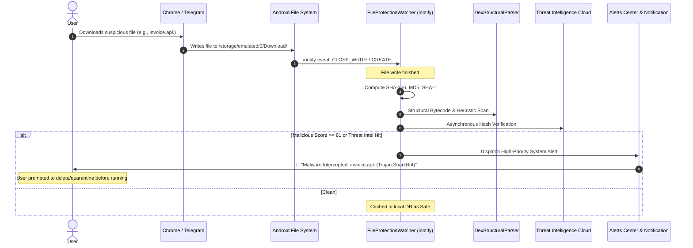

# Chapter 3: Antivirus, Real-Time File Watcher & Malware Defense

[⬅️ Chapter 2: Smart Firewall & NAC](02_FIREWALL_AND_NETWORK_ACCESS_CONTROL.md) | [🏠 Table of Contents](README.md) | [➡️ Chapter 4: Threat Intelligence API Setup](04_THREAT_INTELLIGENCE_API_SETUP.md)

---

KotSafe features a multi-tiered **Malware Defense Architecture** designed to detect and eliminate malicious Android binaries, banking trojans, spyware, and zero-day droppers. It combines real-time kernel file monitoring, structural Dalvik bytecode parsing, Shannon entropy mathematics, YARA signature matching, and comprehensive MITRE ATT&CK for Mobile mapping.

---

## 1. Antivirus Scanning Modes

KotSafe provides two primary scanning modes from the **Antivirus** dashboard:

| Scan Mode | Target Files & Scope | Duration | Engine Depth | Best Used For |
| :--- | :--- | :---: | :---: | :--- |
| **Quick Scan** | High-risk folders: `/Download`, Chrome/Firefox caches, Telegram, WhatsApp media directories, and recent APK binaries. | 10 – 25 sec | Hashes + Structural Parser | Daily routine checks and immediate post-download verification. |
| **Full Deep Scan** | Comprehensive recursive traversal of internal storage, SD cards, installed application packages, and system framework binaries. | 1 – 3 min | Hashes + YARA + Full Heuristic DEX Matrix | Initial system audits, forensic analysis, or when malware symptoms appear. |

### How to Execute a Scan
1. Open **KotSafe** $\rightarrow$ Tap the **Antivirus** tab.
2. Select **Quick Scan** or **Full Deep Scan**.
3. Tap **Start Scan**.
4. The scanner activates a radar sweep interface displaying:
   * Current file path being scanned.
   * Total files processed vs elapsed time.
   * Number of threats discovered in real time.
5. Upon completion, an **Audit Summary Card** displays total files evaluated, scan duration, and detected threats categorized by risk tier (Low, Medium, High, Critical).

---

## 2. Real-Time File Protection Watcher

You do not need to initiate scans manually. KotSafe includes the **File Protection Watcher** (`FileProtectionWatcher.java`), which operates identically to enterprise endpoint detection and response (EDR) agents:



### Technical Operation:
* **Linux `inotify` Hooks**: Utilizing Android's native `FileObserver`, KotSafe monitors file system events (`CLOSE_WRITE`, `MOVED_TO`) across all primary download and messenger inbound directories.
* **Instant Multi-Hashing**: When a file completes writing, KotSafe computes its **SHA-256**, **SHA-1**, and **MD5** hashes within milliseconds using buffered native streams.
* **Zero Battery Wake-Locks**: The watcher is purely event-driven; it consumes 0% CPU when no new files are being written to storage.

---

## 3. APK Pre-Install Scanner

Installing untrusted `.apk` packages downloaded from third-party websites, SMS links, or Telegram channels represents the single largest vector of Android infections. KotSafe's **APK Pre-Install Scanner** (`ApkPreInstallScanner.java`) intercepts package installation attempts before Android's system package manager executes them.

### Structural Bytecode Inspection (`DexStructuralParser.java`)
Unlike primitive antivirus tools that only read the package name and permissions, KotSafe opens the APK container as a zip archive and performs zero-execution bytecode inspection on `classes.dex`:

1. **Packer / Dropper Detection**:
   * Evaluates the **Asset-to-Code Ratio**.
   * Identifies dropper stubs: an APK containing a tiny DEX file (< 150 KB) coupled with a massive encrypted payload (> 1 MB) in `/assets/` or `/res/raw/` designed to unpack at runtime.
2. **Dynamic Class Loading Detection**:
   * Scans string pools and method references for dangerous runtime loaders:
     * `dalvik.system.DexClassLoader`
     * `dalvik.system.InMemoryDexClassLoader`
     * `dalvik.system.PathClassLoader`
3. **Privilege Escalation & Root Exploits**:
   * Scans for execution of root shells:
     * `/system/bin/su`, `/system/xbin/su`, `/system/bin/sh`
     * `java.lang.ProcessBuilder`
     * `java.lang.Runtime.getRuntime().exec`
4. **SMS & Call Interception Abuse**:
   * Inspects references to telephony APIs commonly abused in banking fraud:
     * `android.telephony.SmsManager.sendTextMessage`
     * `sendMultipartTextMessage`
5. **Reflection Density Analysis**:
   * Quantifies the ratio of obfuscated reflective method invocations (`java.lang.reflect.Method.invoke`, `Class.forName`, `getDeclaredMethod`) to normal method invocations.
6. **Shannon Entropy Mathematics**:
   * Calculates the mathematical randomness (Shannon entropy) of embedded strings:
     $$H(X) = -\sum_{i=1}^{n} P(x_i) \log_2 P(x_i)$$
   * Strings with entropy $> 6.5$ are flagged as encrypted C2 configurations or obfuscated payload URLs.

---

## 4. Heuristic Confidence Scoring (0 to 100)

KotSafe scores analyzed packages using an additive risk matrix capped at 100 points:

| Heuristic Trigger | Detection Indicator | Risk Weight |
| :--- | :--- | :---: |
| **Packer / Dropper Stub** | Tiny DEX bytecode coupled with heavy encrypted asset payload | **+35** |
| **Dynamic Class Loading** | `DexClassLoader` or `InMemoryDexClassLoader` references | **+25** |
| **Dangerous Process Exec** | Calls to `/system/bin/sh`, `/system/bin/su`, or `ProcessBuilder` | **+20** |
| **SMS Fraud Vector** | Covert background SMS transmission methods | **+20** |
| **High Reflection Density** | Reflection call ratio $> 0.08$ | **+15** |
| **High String Entropy** | Obfuscated / encrypted string pool entropy $> 6.5$ | **+10** |

### Risk Tiers & Actions

```
 0               25                          60                           100
 ├───────────────┼───────────────────────────┼────────────────────────────┤
 │     SAFE      │        SUSPICIOUS         │         MALICIOUS          │
 │  Green Badge  │       Yellow Badge        │         Red Badge          │
 └───────────────┴───────────────────────────┴────────────────────────────┘
```

* **0 – 25 (Safe)**: Standard application behavior. Installation permitted.
* **26 – 60 (Suspicious)**: Requires user caution. Displays warning detailing excessive permissions or dynamic reflection hooks.
* **61 – 100 (Malicious)**: Dangerous malware confirmed. KotSafe blocks the installation prompt and recommends immediate deletion.

---

## 5. YARA Rule Engine

KotSafe embeds a lightweight native **YARA Pattern Matching Engine** (`YaraRuleEngine.java`) to detect signature patterns of prevalent mobile threat families:

* **Banking Trojans**: Detects overlay injection routines and accessibility hijacking code matching **SharkBot**, **TeaBot**, **Flubot**, and **Cerberus**.
* **Commercial Spyware**: Flags code signatures associated with **Pegasus**, **Hermit**, and **Predator**.
* **Cryptominers & Adware**: Identifies embedded WebAssembly miners (Coinhive) and aggressive hidden ad-clicking SDKs.

---

## 6. MITRE ATT&CK Matrix for Mobile Mapping

Every threat discovered by KotSafe is mapped to the globally recognized **MITRE ATT&CK Framework for Mobile**. This provides security analysts with structured tactical context:

| MITRE Tactic | Technique ID | Technique Name | What KotSafe Detects |
| :--- | :--- | :--- | :--- |
| **Initial Access** | `T1444` | Drive-By Compromise | File Protection Watcher catches silent APK downloads from malicious sites. |
| **Execution** | `T1407` | Dynamic Code Loading | Identifies `DexClassLoader` and in-memory DEX unpacking in `DexStructuralParser`. |
| **Execution** | `T1626` | Exploitation for Privilege Escalation | Detects runtime shell execution (`/system/bin/su`, `ProcessBuilder`). |
| **Persistence** | `T1624` | Event-Triggered Execution | Flags excessive `BOOT_COMPLETED` receivers designed to auto-start malware. |
| **Defense Evasion** | `T1406` | Obfuscated Files or Information | Shannon string entropy $> 6.5$ flags encrypted payloads and C2 strings. |
| **Credential Access** | `T1417` | Input Capture / Overlay Phishing | Flags accessibility service abuse and overlay permissions (`SYSTEM_ALERT_WINDOW`). |
| **Collection** | `T1430` | Location Tracking | Flags covert background location polling without foreground services. |
| **Exfiltration** | `T1437` | Standard Application Layer Protocol | Network inspection reveals unauthorized background data exfiltration to C2 servers. |

---

## 7. Action Center: Threat Remediation

When a threat is detected:
1. Tap the notification or open **Action Center** $\rightarrow$ **Security Actions**.
2. KotSafe displays the **Evidence Detail Activity**:
   * Full file path and cryptographic hashes (SHA-256).
   * Exact heuristic flags and matching YARA rules.
   * Associated MITRE ATT&CK technique IDs.
3. Available Remediation Actions:
   * **Delete File**: Instantly shreds the malicious APK or binary from storage.
   * **Uninstall Package**: Initiates uninstallation if the app was already installed.
   * **Block Network Access**: Adds the app to the permanent zero-connectivity firewall blacklist.
   * **Export Security Report**: Generates a shareable PDF / JSON forensic report.

---

[⬅️ Chapter 2: Smart Firewall & NAC](02_FIREWALL_AND_NETWORK_ACCESS_CONTROL.md) | [🏠 Table of Contents](README.md) | [➡️ Chapter 4: Threat Intelligence API Setup](04_THREAT_INTELLIGENCE_API_SETUP.md)
