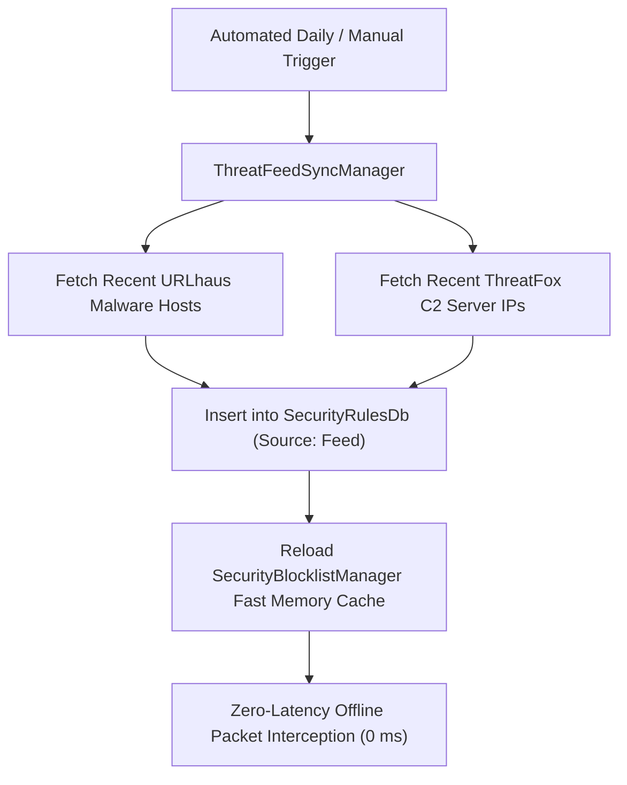
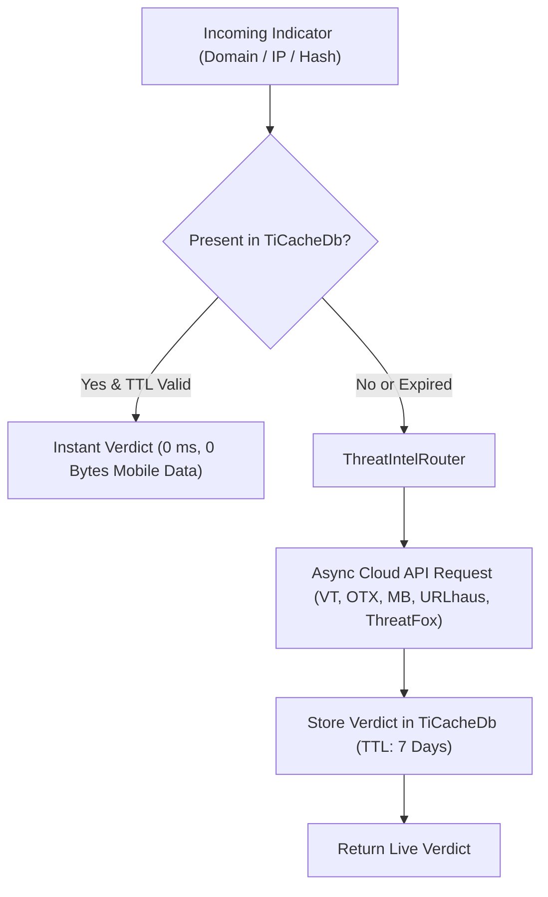

# Chapter 4: Threat Intelligence API Setup Guide


[⬅️ Chapter 3: Antivirus & Malware Defense](03_ANTIVIRUS_AND_MALWARE_DEFENSE.md) | [🏠 Table of Contents](README.md) | [➡️ Chapter 5: TLS Decryption & Inspection](05_TLS_DECRYPTION_AND_INSPECTION.md)

---

KotSafe features a multi-source **Cyber Threat Intelligence (CTI) Core** that correlates real-time network connections, domains, and file hashes against the world's premier threat intelligence repositories. 

While KotSafe provides **100% offline heuristic analysis, YARA scanning, and local threat feeds out of the box**, connecting your free API keys for **VirusTotal**, **AlienVault OTX**, and **MalwareBazaar** transforms KotSafe into an enterprise-grade mobile Security Operations Center (SOC).

---

## 1. Quick Provider Comparison

| Threat Provider | Primary Focus | Free Tier Limits | Cost |
| :--- | :--- | :--- | :---: |
| **VirusTotal** | 70+ Antivirus engines; IP, domain, and file hash consensus | 4 requests / min<br>500 requests / day | **Free** |
| **AlienVault OTX** | Global Indicators of Compromise (IOCs), threat pulses, C2 feeds | Unlimited public lookups | **Free** |
| **MalwareBazaar** | Verified malware sample repository, signature classification | High throughput | **Free** |
| **URLhaus** | Live active malware distribution URLs, drops, and payload hostnames | Free open REST API | **Free** |
| **ThreatFox** | Botnet Command & Control (C2) servers, malware domains, and IOCs | Free open REST API | **Free** |

---

## 2. Privacy Architecture: What Is (and Isn't) Shared

KotSafe enforces strict privacy boundaries when querying threat intelligence feeds:

```
┌───────────────────────────────────────────────────────────┐
│                    DATA PRIVACY GUARANTEE                 │
├───────────────────────────────────────────────────────────┤
│  ✅ What is sent:                                         │
│     • SHA-256 cryptographic hashes of downloaded files    │
│     • Destination domain names & remote IP addresses      │
│                                                           │
│  ❌ What is NEVER sent:                                    │
│     • File contents, images, documents, or personal data  │
│     • User identity, phone numbers, or device identifiers │
│     • Local packet payloads or HTTP headers               │
└───────────────────────────────────────────────────────────┘
```

---

## 3. Provider Setup Walkthroughs

### Provider 1: VirusTotal API Key Setup

**What it does in KotSafe**:
When an APK is downloaded, a background binary is created, or a suspicious IP/domain is contacted, KotSafe hashes the file (SHA-256) and queries 70+ leading antivirus engines (Kaspersky, Sophos, Microsoft Defender, CrowdStrike, SentinelOne) for a consensus verdict.

**Step-by-Step Instructions**:
1. **Visit the Registration Portal**:
   * Navigate to: **[https://www.virustotal.com/gui/join-us](https://www.virustotal.com/gui/join-us)**
2. **Create Your Account**:
   * Fill in your desired **Username**, **Email address**, and a secure **Password**.
   * Accept the Terms of Service and click **Sign Up**.
3. **Verify Your Email Address**:
   * Open the verification email sent from `no-reply@virustotal.com` and click the activation link.
4. **Retrieve Your API Key**:
   * Sign in at **[https://www.virustotal.com/gui/sign-in](https://www.virustotal.com/gui/sign-in)**.
   * Click on your **User Profile avatar** in the top-right corner.
   * From the dropdown menu, select **API Key**.
   * Click the **Copy** icon next to your 64-character hexadecimal key (e.g., `4a7b9c...`).
5. **Configure in KotSafe**:
   * Open **KotSafe** $\rightarrow$ Tap the gear icon **Settings** $\rightarrow$ **Threat Intelligence & API Keys**.
   * Tap **VirusTotal API Key**, paste your key, and tap **Save**.

> [!NOTE]
> **Automatic Rate Limiter (`VtRateLimitedQueue.java`)**:
> VirusTotal limits free API keys to **4 requests per minute**. KotSafe includes an internal rate-limiting queue that automatically buffers and throttles lookups, preventing HTTP 429 quota exhaustion and account suspensions.

---

### Provider 2: AlienVault OTX (Open Threat Exchange) API Setup

**What it does in KotSafe**:
AlienVault OTX by AT&T Cybersecurity is one of the world's largest crowd-sourced computer security communities. It provides real-time community pulses, botnet IP lists, Command & Control (C2) domains, and threat actor indicators. KotSafe queries OTX to detect emerging zero-day infrastructure.

**Step-by-Step Instructions**:
1. **Visit the OTX Portal**:
   * Navigate to: **[https://otx.alienvault.com/](https://otx.alienvault.com/)**
2. **Sign Up for a Free Account**:
   * Click **Sign Up** in the upper right (or visit **[https://otx.alienvault.com/signup](https://otx.alienvault.com/signup)**).
   * Enter your **Username**, **Email Address**, and **Password**. Complete the captcha and click **Sign Up**.
3. **Confirm Email**:
   * Click the activation link sent to your registered email address.
4. **Retrieve DirectConnect API Key**:
   * Log into your OTX Dashboard.
   * Click on your **User Avatar / Username** in the top right $\rightarrow$ select **Settings**.
   * In the left sidebar under Account Settings, click **OTX DirectConnect** (or navigate directly to **[https://otx.alienvault.com/api](https://otx.alienvault.com/api)**).
   * Click **Copy Key** to copy your unique 64-character OTX token.
5. **Configure in KotSafe**:
   * Open **KotSafe** $\rightarrow$ **Settings** $\rightarrow$ **Threat Intelligence & API Keys**.
   * Tap **AlienVault OTX Key**, paste your token, and tap **Save**.

---

### Provider 3: MalwareBazaar (abuse.ch) Setup

**What it does in KotSafe**:
Operated by **abuse.ch**, MalwareBazaar collects verified malware samples and threat actor signatures. KotSafe queries MalwareBazaar for instant malware classification (e.g., Banking Trojans, Pegasus Spyware, Joker, SharkBot).

**Step-by-Step Instructions**:
1. **Visit the MalwareBazaar Portal**:
   * Navigate to: **[https://bazaar.abuse.ch/](https://bazaar.abuse.ch/)**
2. **Access the API Section**:
   * Navigate to: **[https://bazaar.abuse.ch/api/](https://bazaar.abuse.ch/api/)**
3. **Authenticate via OAuth (Optional)**:
   * Click **Login / Register** in the top navigation bar.
   * Authenticate using your **GitHub**, **Twitter (X)**, or **Google/Auth0** account for security researcher verification.
4. **Configure in KotSafe**:
   * Open **KotSafe** $\rightarrow$ **Settings** $\rightarrow$ **Threat Intelligence & API Keys**.
   * Paste your optional Auth-Key or use the default open tier.

---

### Provider 4: URLhaus (abuse.ch) Setup

**What it does in KotSafe**:
URLhaus tracks active, live malware distribution sites, fraudulent landing pages, and malicious payload drops across the web. KotSafe checks accessed URLs, domains, and payload hashes against URLhaus in real time.

**Step-by-Step Instructions**:
1. **Access the URLhaus Portal**:
   * Navigate to: **[https://urlhaus.abuse.ch/](https://urlhaus.abuse.ch/)**
2. **API Documentation & Keys**:
   * URLhaus queries work **out-of-the-box with no API key required**.
   * To add an optional high-rate Auth-Key, log into abuse.ch and copy your Auth-Key into **URLhaus Auth-Key** in KotSafe settings.

---

### Provider 5: ThreatFox (abuse.ch) Setup

**What it does in KotSafe**:
ThreatFox is a free platform by abuse.ch to share indicators of compromise (IOCs) associated with malware, including botnet Command & Control (C2) IPs, Trojan payload delivery domains, and malware hashes.

**Step-by-Step Instructions**:
1. **Access the ThreatFox Portal**:
   * Navigate to: **[https://threatfox.abuse.ch/](https://threatfox.abuse.ch/)**
2. **Configure in KotSafe**:
   * Open **KotSafe** $\rightarrow$ **Settings** $\rightarrow$ **Threat Intelligence & API Keys**.
   * Toggle **Enable ThreatFox Provider** to ON.
   * Enter your optional abuse.ch Auth-Key for elevated rate allowances.

---

## 4. Live Threat Feed Synchronization (`ThreatFeedSyncManager.java`)

To protect your device even without an active internet lookup connection, KotSafe includes **Live Threat Feed Synchronization**:



* **Zero-Latency Offline Blocking**: Synchronized IOCs are stored directly in `SecurityRulesDb`, dropping connections instantly at the packet layer without needing cloud roundtrips.
* **One-Tap Manual Sync**: Tap **Sync Threat Feeds Now** in Settings to immediately ingest the freshest worldwide threat indicators.

---

## 5. Threat Intelligence Caching (`TiCacheDb.java`)

To ensure minimal mobile data usage and preserve your free API quotas, KotSafe incorporates an internal SQLite threat cache:



* **7-Day Default TTL**: Clean reputation results are cached for 7 days.
* **Malware Hits Cached Permanently**: Once a hash or domain is confirmed malicious by threat intelligence, it remains permanently blocked until manually cleared.

---

## 6. Diagnostic Self-Test Connectivity Suite

KotSafe includes an automated diagnostics suite to verify that your API credentials are functional:

1. In KotSafe, go to **Settings** $\rightarrow$ **Threat Intelligence & API Keys**.
2. Tap **Test Connection** under any provider.
3. KotSafe runs safe canary lookups against each provider:

| Test Item | Target Endpoint / Indicator | Expected Result |
| :--- | :--- | :--- |
| **VirusTotal** | Queries safe IP (`8.8.8.8`) | `HTTP 200: CONNECTED (OK)` |
| **AlienVault OTX** | Authenticates against `/api/v1/user/me` | `HTTP 200: CONNECTED (OK)` |
| **MalwareBazaar** | Tests hash lookup endpoint reachability | `HTTP 200: CONNECTED (OK)` |
| **URLhaus** | Tests recent malware URL feed reachability | `HTTP 200: CONNECTED (OK)` |
| **ThreatFox** | Tests live IOC endpoint query | `HTTP 200: CONNECTED (OK)` |

---

[⬅️ Chapter 3: Antivirus & Malware Defense](03_ANTIVIRUS_AND_MALWARE_DEFENSE.md) | [🏠 Table of Contents](README.md) | [➡️ Chapter 5: TLS Decryption & Inspection](05_TLS_DECRYPTION_AND_INSPECTION.md)
