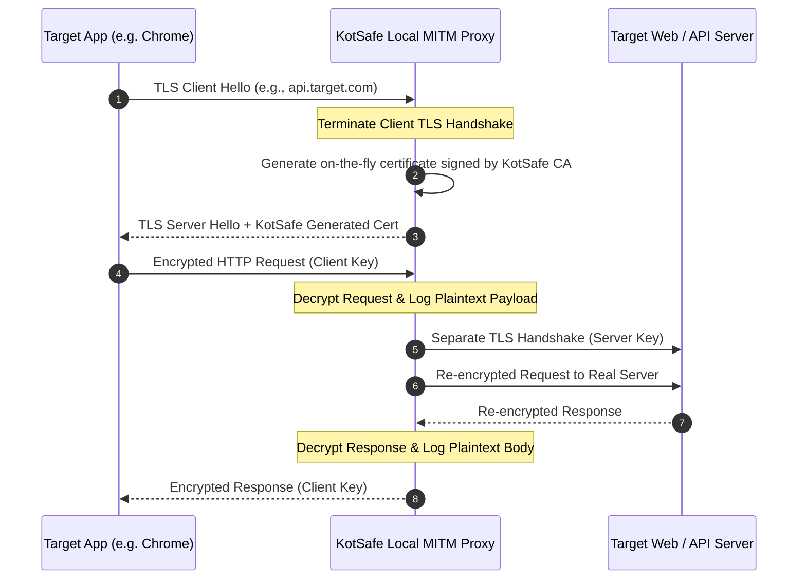

# Chapter 5: TLS Decryption, Traffic Inspection & PCAP Export

[⬅️ Chapter 4: Threat Intelligence API Setup](04_THREAT_INTELLIGENCE_API_SETUP.md) | [🏠 Table of Contents](README.md) | [➡️ Chapter 6: In-App HTTP Repeater & Analysis](06_HTTP_REPEATER_AND_ANALYSIS.md)

---

Over 95% of modern mobile application traffic is encrypted using Transport Layer Security (TLS/HTTPS). KotSafe provides a built-in **Man-In-The-Middle (MITM) Decryption Engine** that allows cybersecurity researchers, mobile penetration testers, and privacy-conscious users to inspect encrypted HTTP/HTTPS payloads, examine REST/GraphQL API calls, and export packet captures for deep analysis in Wireshark.

---

## 1. How In-App MITM Decryption Works



1. **Transparent Redirection**: KotSafe redirects target TCP port 443 sockets to its internal proxy engine.
2. **On-the-Fly Dynamic Certificate Generation**: KotSafe issues ephemeral X.509 certificates matching the target domain, signed by a unique, locally generated Certificate Authority (CA) private key.
3. **Dual Connection Management**: KotSafe terminates the client handshake and initiates a separate, verified TLS connection to the remote destination, recording the unencrypted payload between the two sessions.

---

## 2. Decryption Setup Wizard & CA Certificate Installation

To inspect encrypted traffic, your Android device must trust KotSafe's root Certificate Authority:

### Step 1: Launch the Decryption Wizard
1. Open **KotSafe** $\rightarrow$ Tap the gear icon **Settings** $\rightarrow$ **TLS Decryption**.
2. Toggle **Enable TLS Decryption** to **ON**.
3. The **Setup Wizard** will automatically initialize.

### Step 2: Install CA Certificate (Android 7 through Android 15)

The installation procedure varies depending on your Android OS version:

#### Android 11 and Older:
1. When prompted by KotSafe, tap **Install Certificate**.
2. Name the certificate `KotSafe CA`.
3. Select credential type: **VPN and Apps**.
4. Tap **OK** and confirm your lock screen PIN/biometrics.

#### Android 12, 13, 14, and 15:
Android 12+ requires manual confirmation through system settings:
1. In KotSafe's wizard, tap **Export CA Certificate**. The certificate (`kotsafe_ca.pem`) is saved to your `/Download` folder.
2. Open Android **Settings** $\rightarrow$ **Security & Privacy** $\rightarrow$ **More Security Settings** (or **Encryption & Credentials**).
3. Tap **Install a certificate** $\rightarrow$ Select **CA certificate**.
4. Android displays a security warning (*"Your data won't be private"*). Tap **Install anyway**.
5. Browse to your `/Download` folder and select `kotsafe_ca.pem`.
6. Confirm with your PIN/fingerprint. A system toast confirms: *"CA certificate installed"*.

---

## 3. Navigating Android 7+ Application Trust Restrictions

Starting with Android 7.0 (Nougat), Google introduced the **Network Security Configuration**. By default, production apps only trust system-installed CAs, ignoring user-installed CAs.

```
┌────────────────────────────────────────────────────────────────────────┐
│               HOW APPS EVALUATE CERTIFICATES ON ANDROID 7+             │
├────────────────────────────────────────────────────────────────────────┤
│  • Browsers (Chrome, Firefox, Brave):                                  │
│    ✅ Trust user-installed CA certificates out of the box.            │
│                                                                        │
│  • Standard Third-Party Apps (Social, Banking, Games):                 │
│    ⚠️ Ignore user CAs unless explicitly configured in app manifest.    │
│                                                                        │
│  • Apps with Certificate Pinning (e.g., Banking, Instagram):           │
│    🔒 Hardcode server public keys; reject all non-pinned certificates. │
└────────────────────────────────────────────────────────────────────────┘
```

### Remediation Strategies:

#### Option A: Non-Root (Debugging Your Own App)
If you are testing an application you develop, add this file to `res/xml/network_security_config.xml`:

```xml
<?xml version="1.0" encoding="utf-8"?>
<network-security-config>
    <base-config cleartextTrafficPermitted="true">
        <trust-anchors>
            <certificates src="system" />
            <certificates src="user" />
        </trust-anchors>
    </base-config>
</network-security-config>
```

#### Option B: Rooted Devices (Magisk / KernelSU)
To decrypt third-party production applications:
1. Install the Magisk module **AlwaysTrustUserCerts** (or **Move Certificates**).
2. This module automatically mounts certificates from the user store (`/data/misc/user/0/cacerts-added/`) into the system trust store (`/system/etc/security/cacerts/`).
3. Standard applications will now trust the KotSafe CA without modification.

#### Option C: Certificate Pinning Bypass (LSPosed / Xposed)
For applications enforcing hardcoded public key pinning:
1. Install **LSPosed Framework** on your rooted device.
2. Enable the **TrustMeAlready** or **JustTrustMe** module for the target app.
3. The module hooks `TrustManagerImpl` in memory to bypass pinning checks.

---

## 4. Selective Per-App Decryption

Terminating TLS connections consumes CPU cycles and increases battery drain. KotSafe allows you to selectively decrypt only the applications under test:

1. In **TLS Decryption Settings**, tap **Decryption List**.
2. Select your preferred mode:
   * **Decrypt Selected Apps Only (Recommended)**: Check only the specific apps you want to inspect (e.g., Google Chrome or your app under test). All other device traffic passes through unhindered.
   * **Decrypt All Except**: Decrypts all device traffic except apps explicitly added to an exclusion list (useful for isolating all traffic except streaming apps).

---

## 5. Exporting Captures & Live Streaming

KotSafe provides multiple industry-standard export methods for downstream forensic analysis:

### A. Live Wireshark Streaming (PCAP-over-IP)
Stream packets in real time over Wi-Fi or USB to Wireshark running on your workstation:

1. In KotSafe, go to **Settings** $\rightarrow$ **PCAP Capture** $\rightarrow$ Set **Dump Mode** to **PCAP-over-IP**.
2. Start the capture in KotSafe. Note your device's IP address and the displayed port (default: `1234`).
3. On your computer (Linux, macOS, or Windows WSL), run:
   ```bash
   # Stream live traffic into Wireshark
   nc 192.168.1.150 1234 | wireshark -k -i -
   ```
4. Wireshark will immediately display packets in real time as they traverse your Android device!

### B. SSLKEYLOGFILE Wireshark Decryption
If you prefer not to install the CA certificate onto your desktop workstation, you can export KotSafe's TLS master secrets:

1. In KotSafe, go to **Settings** $\rightarrow$ **TLS Decryption** $\rightarrow$ Enable **Export SSLKEYLOGFILE**.
2. Run your capture session, then stop capture and export `sslkeylog.txt` along with the `.pcap` file.
3. In Wireshark on your computer:
   * Navigate to **Edit** $\rightarrow$ **Preferences** $\rightarrow$ **Protocols** $\rightarrow$ **TLS**.
   * Set **(Pre)-Master-Secret log filename** to your exported `sslkeylog.txt`.
   * Wireshark will automatically decrypt the captured TLS sessions.

### C. HTTP Archive (HAR) Export
1. In KotSafe, navigate to the **Connections** tab.
2. Tap any HTTP/HTTPS connection row, or use the multi-select filter.
3. Tap the **Share / Export** icon $\rightarrow$ Select **Export as HAR (HTTP Archive)**.
4. Drag and drop the resulting `.har` file directly into **Chrome DevTools Network tab**, **Burp Suite**, or **Postman** for rapid API debugging.

---

[⬅️ Chapter 4: Threat Intelligence API Setup](04_THREAT_INTELLIGENCE_API_SETUP.md) | [🏠 Table of Contents](README.md) | [➡️ Chapter 6: In-App HTTP Repeater & Analysis](06_HTTP_REPEATER_AND_ANALYSIS.md)
