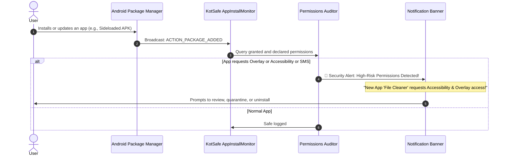

# Chapter 7: App Permissions Inspector & Privacy Audit

[⬅️ Chapter 6: In-App HTTP Repeater & Analysis](06_HTTP_REPEATER_AND_ANALYSIS.md) | [🏠 Table of Contents](README.md) | [➡️ Chapter 8: Alerts Center & Remediation](08_ALERTS_CENTER_AND_REMEDIATION.md)

---

Android applications frequently abuse system privileges to spy on user activity, harvest contacts, hijack one-time passwords (OTPs), and display deceptive phishing screens over legitimate banking apps.

KotSafe provides an **App Permissions Inspector** and real-time **App Install Monitor** (`AppInstallMonitor.java` and `AppPermissionsActivity.java`) to audit, categorize, and control the capabilities granted to every application on your device.

---

## 1. High-Risk Permission Categories

KotSafe audits installed applications for specific privilege combinations historically abused by Android malware, stalkerware, and aggressive ad networks:

| Permission / Capability | Android Manifest Identifier | Malicious Threat Scenario |
| :--- | :--- | :--- |
| **Draw Over Other Apps (Overlay)** | `SYSTEM_ALERT_WINDOW` | Creates transparent or cloned login windows over legitimate banking/crypto apps to steal credentials (Overlay Phishing). |
| **Accessibility Service** | `BIND_ACCESSIBILITY_SERVICE` | Reads screen text, steals keystrokes (Keylogging), intercepts 2FA codes, and automatically taps "Allow" on permission prompts. |
| **Notification Listener** | `BIND_NOTIFICATION_LISTENER_SERVICE` | Silently reads incoming SMS and chat notifications to intercept one-time authentication passcodes. |
| **SMS Reading & Sending** | `READ_SMS`, `RECEIVE_SMS`, `SEND_SMS` | Subscribes the device to premium SMS services and intercepts bank verification codes. |
| **Background Location** | `ACCESS_BACKGROUND_LOCATION` | Continuously tracks physical GPS movement without an active foreground user interface. |
| **Microphone & Camera** | `RECORD_AUDIO`, `CAMERA` | Covert eavesdropping and unauthorized surveillance (Stalkerware). |
| **Device Administrator** | `BIND_DEVICE_ADMIN` | Locks the device screen, changes lock passwords, and prevents the user from uninstalling the application. |

---

## 2. The Permission Audit Dashboard

To launch an audit of your device:

1. Open **KotSafe** $\rightarrow$ Open the navigation drawer $\rightarrow$ Tap **Security & Privacy** $\rightarrow$ **App Permissions Audit**.
2. KotSafe inspects the Android `PackageManager` database and categorizes all installed apps into distinct threat tiers:

```
┌──────────────────────────────────────────────────────────────┐
│  App Permissions Audit                                       │
├──────────────────────────────────────────────────────────────┤
│  [🔴 High Risk: 4]    [🟡 Medium Risk: 12]    [🟢 Low: 68]   │
├──────────────────────────────────────────────────────────────┤
│                                                              │
│  🔴 Flashlight Pro (com.flashlight.utility)                 │
│     Capabilities: Overlay Window, Read SMS, Audio Recording │
│     [Revoke Permissions]                   [Uninstall App]   │
│                                                              │
│  🔴 Fast PDF Viewer (com.fastpdf.free)                       │
│     Capabilities: Accessibility Service, Draw Over Apps      │
│     [Revoke Permissions]                   [Uninstall App]   │
│                                                              │
│  🟡 Weather Daily (com.weather.daily)                        │
│     Capabilities: Background Location, Ignore Battery Opt    │
│     [Manage Permissions]                                     │
└──────────────────────────────────────────────────────────────┘
```

3. **Color-Coded Badges**:
   * 🔴 **High Risk**: Apps requesting lethal privilege combinations (e.g., a utility or game requesting SMS, Accessibility, or Overlay permissions).
   * 🟡 **Medium Risk**: Apps requesting sensitive personal data (e.g., continuous background location or access to contacts).
   * 🟢 **Low Risk**: Standard applications with sandboxed permissions appropriate to their category.

---

## 3. Real-Time App Install Monitor (`AppInstallMonitor.java`)

You do not need to periodically run manual audits. KotSafe actively watches the Android package management system:



### Key Monitor Features:
* **Update Tampering Detection**: Alerts you if an existing, benign application pushes an update via a third-party source that suddenly requests high-risk permissions.
* **Instant Direct Action**: Tapping the alert notification opens the system settings page directly, enabling you to revoke dangerous permissions with a single tap.

---

## 4. Remediation Workflow: Revoking Permissions

When KotSafe identifies an app with excessive permissions:

1. Tap on the application entry in the **App Permissions Audit** list.
2. Review the **Permissions Analysis Card**:
   * **Granted Permissions**: Privileges currently active.
   * **Why It's Dangerous**: Detailed explanation of potential exploit vectors.
3. Tap **Revoke in System Settings**:
   * KotSafe opens the native Android **App Info** screen.
   * Under **Permissions**, toggle the dangerous permission to **Don't allow**.
4. If the application appears to be malware or provides no legitimate functionality justifying its permissions, tap **Uninstall Application** to completely remove it from your device.

---

[⬅️ Chapter 6: In-App HTTP Repeater & Analysis](06_HTTP_REPEATER_AND_ANALYSIS.md) | [🏠 Table of Contents](README.md) | [➡️ Chapter 8: Alerts Center & Remediation](08_ALERTS_CENTER_AND_REMEDIATION.md)
