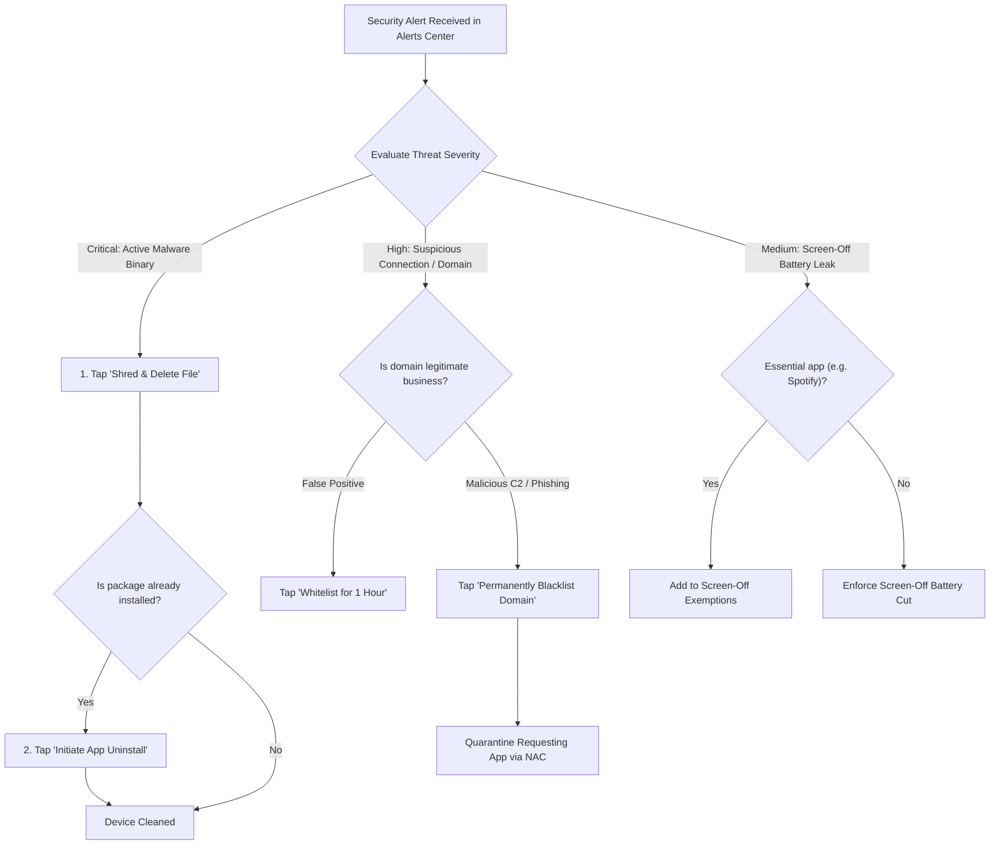

# Chapter 8: Alerts Center, Threat Remediation & Action Center

[⬅️ Chapter 7: App Permissions & Privacy Audit](07_APP_PERMISSIONS_AND_PRIVACY.md) | [🏠 Table of Contents](README.md) | [➡️ Chapter 9: Troubleshooting & Backup](09_TROUBLESHOOTING_AND_BACKUP.md)

---

A modern security platform must provide clear visibility into threats and offer immediate, actionable remediation. KotSafe centralizes all detected anomalies, blocked sockets, antivirus hits, and permission violations into two unified hubs: the **Alerts Center** (`AlertsCenterActivity.java`) and the **Action Center** (`SecurityActionsActivity.java`).

---

## 1. The Alerts Center

The Alerts Center serves as your mobile Security Operations Center (SOC) dashboard. Whenever the firewall blocks an unauthorized socket, the File Protection Watcher catches a dropper, or SmartScreen intercepts a phishing URL, an event is logged in `AlertStore.java`.

```
┌──────────────────────────────────────────────────────────────┐
│  Alerts Center                                      [Filter] │
├──────────────────────────────────────────────────────────────┤
│  [🔴 Critical: 1]   [🟠 High: 3]   [🟡 Medium: 5]   [Total: 9]│
├──────────────────────────────────────────────────────────────┤
│  Filters: [ All ]  [ Firewall ]  [ Antivirus ]  [ SmartScreen ]
├──────────────────────────────────────────────────────────────┤
│                                                              │
│  🔴 CRITICAL • Antivirus Watcher • 2 mins ago                │
│     Malicious APK Intercepted: BankingTrojan_update.apk      │
│     Detection: DexStructuralParser (Score: 85/100)           │
│     [View Forensic Evidence]             [Delete & Dismiss]  │
│                                                              │
│  🟠 HIGH • SmartScreen Interception • 14 mins ago            │
│     Phishing Domain Blocked: secure-bank-login-verify.com    │
│     App: Google Chrome • Threat Feed: VirusTotal Consensus   │
│     [View Details]                         [Add to Whitelist]│
│                                                              │
│  🟡 MEDIUM • Smart Firewall • 1 hr ago                       │
│     Screen-Off Leak Blocked: AdTracker SDK (UID 10188)       │
│     App: Free Casual Game • Physical Interface: Wi-Fi        │
│     [View Rule]                            [Create Exemption]│
└──────────────────────────────────────────────────────────────┘
```

### Filtering & Triage:
* **Severity Counters**: Immediate tally of active threats grouped by risk tier (Critical, High, Medium, Low).
* **Filter Chips**: Filter events by subsystem:
  * **Firewall**: Denied socket attempts and screen-off leaks.
  * **Antivirus**: File hashes, YARA hits, and structural bytecode anomalies.
  * **SmartScreen**: Browser phishing and malicious URL interceptions.
  * **Threat Intel**: Cloud IOC matches from VirusTotal, OTX, or MalwareBazaar.

---

## 2. Forensic Evidence Detail (`EvidenceDetailActivity.java`)

Tapping any alert opens a deep forensic analysis card detailing the exact anatomy of the threat:

```
┌──────────────────────────────────────────────────────────────┐
│  Forensic Evidence Details                                   │
├──────────────────────────────────────────────────────────────┤
│  File: /storage/emulated/0/Download/Invoice_PDF.apk          │
│  Threat Name: Trojan.AndroidOS.SharkBot.gen                  │
│  Confidence Score: 92 / 100 (MALICIOUS)                      │
├──────────────────────────────────────────────────────────────┤
│  Cryptographic Hashes:                                       │
│  SHA-256: 8f4b13a8c790d9e32f7a01b6...                       │
│  MD5:     a94f1b20c38d1045e...                              │
├──────────────────────────────────────────────────────────────┤
│  Static Analysis Indicators:                                 │
│  • Packer Stub Detected (Asset-to-Code Ratio: 14.8)          │
│  • Dynamic Loading: dalvik.system.InMemoryDexClassLoader     │
│  • Shell Execution: /system/bin/su, ProcessBuilder           │
│  • String Entropy: 7.14 (High Obfuscation)                   │
├──────────────────────────────────────────────────────────────┤
│  MITRE ATT&CK for Mobile:                                    │
│  • T1407 (Dynamic Code Loading)                              │
│  • T1626 (Privilege Escalation via Shell)                    │
│  • T1417 (Input Capture / Overlay Phishing)                  │
├──────────────────────────────────────────────────────────────┤
│  [SHRED & DELETE FILE]                   [SHARE AUDIT LOG]   │
└──────────────────────────────────────────────────────────────┘
```

---

## 3. The Action Center (`SecurityActionsActivity.java`)

The Action Center is your central administrative console for active security controls and enforcement rules:

* **Active Firewalled Apps**: Displays every application currently subjected to custom NAC rules (Wi-Fi, 5G, screen-off, or LAN isolation).
* **Quarantined Applications**: Lists apps that have been completely isolated from all local and remote network communication.
* **Active Whitelist Exceptions**: View, edit, or revoke temporary 1-hour and permanent whitelist entries.
* **Threat Feed Overrides**: Review domains and IPs blocked via live threat intelligence feeds.

---

## 4. Incident Response & Threat Remediation Workflows

When an alert triggers, follow this standard incident response procedure:



### Remediation Actions Explained:
1. **Shred & Delete**: Directly unlinks and overwrites the malicious binary from local storage, preventing accidental execution.
2. **Quarantine Application**: Immediately flips the target app's firewall rule to **Deny All**, severing its communication with Command & Control (C2) servers while you investigate.
3. **Export Incident Log**: Generates a structured JSON/text report containing file hashes, timestamps, and MITRE tactics for submission to your IT department or security team.

---

[⬅️ Chapter 7: App Permissions & Privacy Audit](07_APP_PERMISSIONS_AND_PRIVACY.md) | [🏠 Table of Contents](README.md) | [➡️ Chapter 9: Troubleshooting & Backup](09_TROUBLESHOOTING_AND_BACKUP.md)
