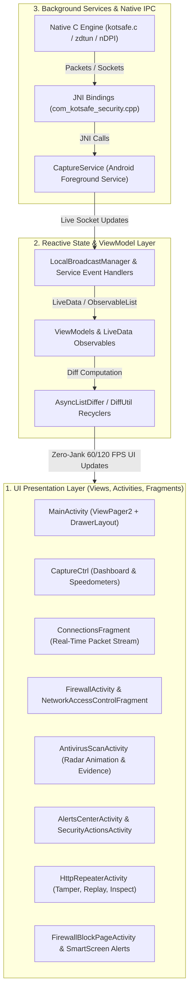
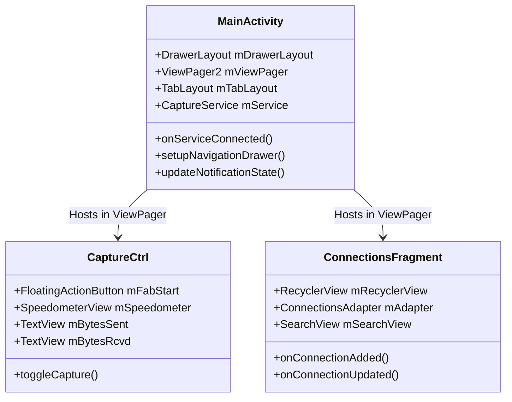
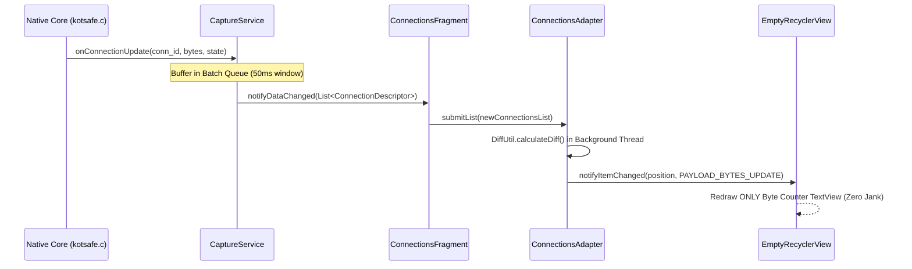
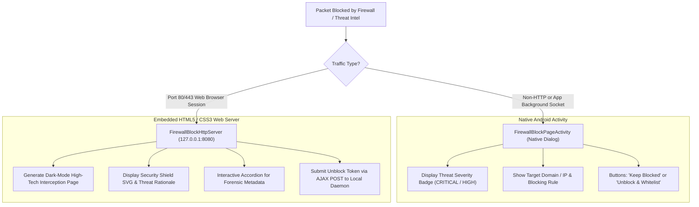
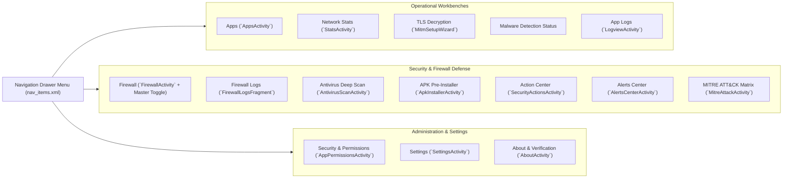
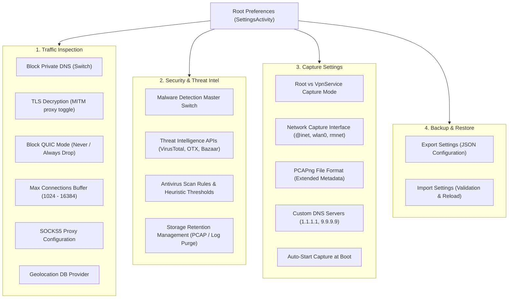

# KotSafe: Complete Frontend Architecture & UI System

The frontend architecture of **KotSafe** is engineered to deliver enterprise-grade cybersecurity controls, real-time packet inspection (10,000+ packets/sec), and instant forensic feedback on modern Android devices without sacrificing UI responsiveness or battery longevity.

Built around **Material Design 3 (Material You)**, reactive event streams, and decoupled presentation layers, the interface pairs a futuristic cybersecurity aesthetic with hardened stability.

---

## 🏛️ High-Level Architectural Layers

KotSafe's frontend follows the **Model-View-ViewModel (MVVM)** and **Reactive Presenter** patterns, separating background low-level packet capture from Android UI components:

---

## 📱 Visual Showcase & Real Screen Gallery

KotSafe features specialized interactive screens for every phase of mobile security and network analysis:

### 1. Main Dashboard & Real-Time Traffic Stream
| Capture Dashboard (`CaptureCtrl`) | Live Packet Stream (`ConnectionsFragment`) |
| :---: | :---: |
|  |  |
| **Authentic device capture: real-time network speedometers, active session counter, instant capture start/stop, and quick toggle bar.** | **Sub-millisecond connection stream with app attribution, L4/L7 protocol labels, domain SNI, and status pills.** |

---

### 2. Deep Forensics & Traffic Inspection
| Connection Details (`ConnectionDetailsActivity`) | Payload Hex / ASCII (`PayloadAdapter`) |
| :---: | :---: |
|  |  |
| **Comprehensive socket metrics: source/dest IPs, port mapping, TLS handshake version, cipher suite, and geo-IP.** | **Deep hex-dump, ASCII stream, HTTP header dissection, and byte-level payload export for Wireshark analysis.** |

---

### 3. Threat Defense, Firewall & Antivirus
| Antivirus Deep Scan (`AntivirusScanActivity`) | Action Center & Rules (`SecurityActionsActivity`) |
| :---: | :---: |
|  |  |
| **Authentic device capture: visual radar sweep animation with live file hash calculation, Shannon entropy, and YARA signature analysis.** | **Authentic device capture: unified rule management, domain blocking, application quarantine, and whitelist overrides.** |

---

### 4. Smart Interception & Security Blocks
| Native Security Warning (`FirewallBlockPageActivity`) | Browser SmartScreen (`127.0.0.1:8080`) |
| :---: | :---: |
|  |  |
| **System-wide blocking dialog displaying threat severity score, MITRE attack tags, risk rationale, and unblock button.** | **Embedded HTTP server rendering an interactive responsive HTML5 warning inside Chrome/Edge when malware is blocked.** |

---

### 5. Slide-out Navigation Drawer (Navbar) & System Settings
| Slide-out Navigation Drawer (Upper & Scrolled) | Comprehensive Settings System (Upper & Scrolled) |
| :---: | :---: |
|    *(Top: Apps, Stats, TLS, Firewall, Antivirus)*       *(Bottom: Action Center, Alerts, Permissions, Settings)* |    *(Top: Private DNS, TLS, QUIC, Threat Intel)*       *(Bottom: Root mode, PCAPng, DNS, Backup/Restore)* |
| **Complete Panoramic Navigation Drawer** | **Complete Panoramic Stitched Settings (1080×6415)** |
|  |  |

---

## 🔍 Detailed Component & Activity Architecture

### 1. Root Container: `MainActivity.java`
* **Layout File**: [`res/layout/main_activity.xml`](file:///home/kali/Documents/KotSafe/app/src/main/res/layout/main_activity.xml)
* **Design Components**:
  * `DrawerLayout`: Left-side navigation drawer exposing quick links to Firewall, Antivirus, Action Center, Permissions, Settings, and About.
  * `TabLayout` + `ViewPager2`: Seamless horizontal swiping between the core operational tabs:
    1. **Status / Dashboard Tab** (`CaptureCtrl.java`): Central power button, live bandwidth meters, capture status badges, and quick-toggle chips.
    2. **Connections Tab** (`ConnectionsFragment.java`): Virtualized scrolling table of all active and historical TCP/UDP/ICMP flows.
* **Lifecycle & Service Binding**:
  * Binds to `CaptureService` using `ServiceConnection`.
  * Observes capture states: `STATUS_STOPPED`, `STATUS_STARTING`, `STATUS_CAPTURING`, `STATUS_PAUSED`.

---

### 2. High-Performance Packet Stream: `ConnectionsFragment.java` & `ConnectionsAdapter.java`
Network monitoring on mobile devices frequently handles hundreds of new socket connections per second. A naive ListView or standard RecyclerView adapter would cause severe UI stuttering ("jank") and battery drain.

KotSafe solves this through a multi-tier rendering pipeline:
1. **Ring-Buffer Batching**: `CaptureService` buffers connection events and flushes them to the UI thread in 50ms time-quantized batches.
2. **`AsyncListDiffer` with Custom Payloads**: `ConnectionsAdapter` utilizes Android's `DiffUtil` to update only the specific changed text view (e.g., updating transferred byte counter without re-binding the entire row, app icon, or domain text).
3. **View Recycling & Icon Caching**: Application icons (`PackageManager`) are cached in a LRU Memory Cache (`LruCache<String, Drawable>`) to prevent expensive IPC calls on scroll.

---

### 3. Firewall & NAC Center: `FirewallActivity.java` & `NetworkAccessControlFragment.java`
* **Layout File**: [`res/layout/activity_firewall.xml`](file:///home/kali/Documents/KotSafe/app/src/main/res/layout/activity_firewall.xml)
* **Capabilities**:
  * **5-Way Network Access Matrix**: Provides granular toggles per application:
    1. 📶 **Wi-Fi Allowed**
    2. 📱 **Mobile Cellular / 5G Allowed**
    3. ✈️ **Roaming Block**
    4. 🔒 **Screen-Off Background Blocker** (cuts telemetry when phone is locked)
    5. 🏠 **Local Area Network (LAN) Isolation**
  * **Whitelist vs Blacklist Mode**: Master radio switch allowing default-deny or default-allow policies.
  * **Quick App Search & Filtering**: Instant filter by UID, package name, system vs user app.

---

### 4. Antivirus Scan & Visual Radar: `AntivirusScanActivity.java`
* **Layout File**: [`res/layout/activity_antivirus_scan.xml`](file:///home/kali/Documents/KotSafe/app/src/main/res/layout/activity_antivirus_scan.xml)
* **Custom Dynamic Animations**:
  * **Radar Sweep**: `res/anim/laser_sweep.xml` rotates a 360-degree holographic gradient beam over concentric target rings (`res/drawable/radar_concentric_circles.xml`).
  * **Pulsing Scanner Ring**: `res/anim/pulse_radar.xml` animates an expanding beacon that dynamically changes color from Neon Cyan (clean) to Critical Crimson (threat detected).
* **Forensic Evidence List**:
  * Backed by `AntivirusEvidenceAdapter.java`.
  * Displays scanned file path, calculated SHA-256 hash, Shannon string entropy score (0.00 – 8.00), detected YARA signature rules, and matched MITRE ATT&CK techniques.

---

### 5. In-App Mobile HTTP Repeater: `HttpRepeaterActivity.java`
* **Layout File**: [`res/layout/activity_http_repeater.xml`](file:///home/kali/Documents/KotSafe/app/src/main/res/layout/activity_http_repeater.xml)
* **Pentesting Workbench**:
  * **Raw Request Editor**: Full-featured text editor with syntax highlighting, line numbers, and custom HTTP header injector.
  * **Method Selector Spinner**: Instant switching between `GET`, `POST`, `PUT`, `DELETE`, `PATCH`, `HEAD`, and `OPTIONS`.
  * **One-Tap Beautifier**: Formats JSON and XML request/response bodies with clean indentation.
  * **Live Replay Engine**: Executes raw HTTP/HTTPS socket dispatch directly from the mobile device and displays HTTP status code, round-trip latency, and formatted response headers.

---

### 6. Interception Screens: Native Alert vs SmartScreen Browser Page
KotSafe provides two distinct frontend block experiences depending on where the threat occurs:

---

### 7. Slide-out Navigation Drawer: Menu Structure & Intent Routing
The Navigation Drawer acts as the central command switchboard of KotSafe, organized into distinct functional operational groups defined in [`res/menu/nav_items.xml`](file:///home/kali/Documents/KotSafe/app/src/main/res/menu/nav_items.xml) and handled by `MainActivity.java` via `onNavigationItemSelected`:

| Upper Drawer (Core & Security) | Scrolled Lower Drawer (Admin & System) | Full Panoramic Drawer (Seamless Stitched) |
| :---: | :---: | :---: |
|  |  |  |

#### Detailed Navigation Drawer Matrix
| Menu Item ID | Title / Label | Destination Activity | Core User Action & Forensic Functionality |
| :--- | :--- | :--- | :--- |
| `item_apps` | **Apps** | `AppsActivity` | Complete list of all installed packages with UID mapping, system/user categorization, and data usage. |
| `action_stats` | **Network Stats** | `StatsActivity` | Top-talkers bar charts, total bandwidth per protocol (DNS, HTTP, TLS, QUIC), and country distribution. |
| `tls_decryption` | **TLS Decryption** | `MitmSetupWizard` | Automated step-by-step assistant for Root CA certificate generation and Android user store setup. |
| `malware_detection` | **Malware Detection** | `MalwareDetection` | Real-time security overview showing active threat intel feeds, blocked domains, and heuristic alerts. |
| `firewall` | **Firewall (Toggle)** | `FirewallActivity` | Integrated switch toggling master firewall protection on/off without leaving the dashboard. |
| `firewall_logs` | **Firewall Logs** | `FirewallActivity` | Chronological ledger of all connection drops, reason codes (Blacklist, NAC, Geo-IP), and timestamps. |
| `nav_antivirus_scan` | **Antivirus Scan** | `AntivirusScanActivity` | Visual radar scanner performing instant Quick Scan or Deep Dalvik bytecode scans across the filesystem. |
| `nav_apk_installer` | **APK Pre-Installer** | `ApkInstallerActivity` | High-security sideload staging environment that analyzes uninstalled APKs for trojans before installation. |
| `nav_security_actions` | **Action Center** | `SecurityActionsActivity` | Rule manager for domain blacklists, whitelists, quick preset toggles (AdGuard, OISD, Abuse.ch), and unblock keys. |
| `nav_alerts_center` | **Alerts Center** | `AlertsCenterActivity` | Centralized incident response console detailing threat severity, MITRE tactics, and file shredding. |
| `nav_attack_framework`| **ATT&CK Framework** | `MitreAttackActivity` | Interactive visualization of adversary behaviors mapped against the MITRE ATT&CK Mobile matrix. |
| `nav_permissions_setup`| **Security & Permissions** | `AppPermissionsActivity` | Audit interface listing dangerous runtime permissions (Camera, Mic, Accessibility, Overlays). |
| `action_settings` | **Settings** | `SettingsActivity` | Complete configuration screen for network capture, proxying, and threat intel APIs. |
| `action_about` | **About** | `AboutActivity` | Application version, open-source licenses, GitHub source repository links, and build metadata. |

---

### 8. Settings Architecture: SharedPreferences & Dynamic Category Screens
KotSafe's settings system is architected as an expandable hierarchy using Android Jetpack's `androidx.preference` library, rooted in [`res/xml/root_preferences.xml`](file:///home/kali/Documents/KotSafe/app/src/main/res/xml/root_preferences.xml):

| Upper Settings (Inspection & Security) | Lower Settings (Capture & Backup) | Complete Panoramic Stitched Settings (1080×6415) |
| :---: | :---: | :---: |
|  |  |  |
| *Top configuration pane showing Private DNS block, TLS Decryption, QUIC blockers, and Threat Intel APIs.* | *Scrolled view showing capture interface selector, PCAPng switches, DNS server configs, and JSON backup/restore.* | *Seamless full-length stitched panoramic screenshot capturing the entire preferences tree from top to bottom.* |

#### Settings Categories & Functional Controls
1. **Traffic Inspection**:
   * **Block Private DNS**: Intercepts DoH/DoT queries to enforce local DNS filtering and prevent bypasses.
   * **TLS Decryption**: Direct toggle enabling the local MITM TLS proxy and root certificate generation.
   * **Block QUIC Protocol**: Drops UDP port 443 packets, forcing web clients (Chrome, YouTube) to fall back to inspectable standard TCP/TLS.
   * **Max Connections Buffer**: Controls the memory-mapped ring-buffer size for connection history (default 8,192 entries).
   * **SOCKS5 Proxy**: Routes all outbound traffic through an upstream Tor, Shadowsocks, or corporate SOCKS5 proxy.
2. **Security & Threat Intelligence**:
   * **Threat Intel APIs**: Dedicated configuration screen ([`threat_intel_preferences.xml`](file:///home/kali/Documents/KotSafe/app/src/main/res/xml/threat_intel_preferences.xml)) storing API keys for **VirusTotal**, **AlienVault OTX**, and **MalwareBazaar** with rate-limiting queues.
   * **Storage Retention**: Manages automatic cleanup rules for packet capture dumps, file hash caches, and event logs to prevent filling device storage.
3. **Capture & Network Configuration**:
   * **Root Mode vs VPN Mode**: Optional root switch allowing raw `libpcap` socket binding on `any` interface for rooted testing environments.
   * **PCAPng Format**: Generates modern PCAP Next Generation files containing interface descriptions and process metadata readable by Wireshark.
   * **Custom DNS Servers**: Overrides cellular or DHCP DNS with privacy-focused resolvers (Cloudflare, Quad9, AdGuard).
4. **Backup & Restore**:
   * **JSON Backup (`SettingsBackupHandler.java`)**: Exports all custom firewall rules, NAC permissions, and API configurations into an encrypted JSON file for seamless migration between devices.

---

## 🎨 Design System & Visual Palette

KotSafe implements an uncompromising dark cybersecurity theme adhering to Material Design 3 guidelines:

### Core Color Palette
| Token Name | Hex Code | Purpose & Semantic Role |
| :--- | :---: | :--- |
| `background_dark` | `#0D1117` | Deep dark slate canvas for maximum contrast and low OLED battery consumption |
| `surface_card` | `#161B22` | Card, dialog, and panel background container with subtle 1dp border |
| `cyan_neon` | `#00E5FF` | Primary brand accent, active state indicators, active capture glow |
| `emerald_safe` | `#00E676` | Verified safe flows, clean scan results, allowed firewall status |
| `crimson_threat` | `#FF1744` | Malicious domain blocks, critical trojans, YARA signature matches |
| `amber_warning` | `#FFC107` | Suspicious entropy (>7.2), untrusted certificates, ad/tracker blocks |
| `sapphire_accent` | `#0D47A1` | Secondary action buttons, header cards, and radar sweep gradient |

### Typography & Iconography
* **Typeface**: Android Roboto / Material Sans with tabular monospaced numbers (`Roboto Mono`) for all IP addresses, port numbers, byte counters, and hash values to prevent layout shifting during rapid updates.
* **Vector Drawables**: 100% resolution-independent vector graphics (`res/drawable/*.xml`) ensuring crisp rendering across smartphones, foldables, and tablets (mdpi to xxxhdpi).

---

## 🛠️ Custom UI Components

KotSafe contains specialized custom Android views located in `app/src/main/java/com/kotsafe/security/views/`:

1. **`EmptyRecyclerView.java`**:
   * Extends `RecyclerView` with an integrated empty-state container view. Automatically toggles between loading spinners, empty-state illustrations, and the live list without layout flickering.
2. **`AppsListView.java`**:
   * High-speed virtualized app selector with real-time package name searching and multi-selection checkboxes.
3. **`DohInspectorDialog.java`**:
   * Interactive modal that decodes DNS-over-HTTPS wire format and presents query/response resource records (A, AAAA, CNAME, TXT) in expandable cards.
4. **`JwtInspectorDialog.java`**:
   * In-app decoder for intercepted JSON Web Tokens. Decodes Base64URL header and payload claims with expiration time analysis.
5. **`ProtobufInspectorDialog.java`**:
   * Dissects unknown binary Google Protocol Buffer payloads into readable field tags and varint values.

---

## 🔄 Lifecycle & Battery Optimization

1. **Window-Aware Animation Suspension**:
   * When `AntivirusScanActivity` or `MainActivity` transitions to `onStop()` or `onPause()`, all vector animations and radar sweeps (`AnimationDrawable`, `ValueAnimator`) are paused immediately to prevent CPU wake-locks.
2. **Screen-Off UI Freezing**:
   * While the screen is locked, `CaptureService` continues native packet inspection in the Linux kernel while suspending UI DiffUtil calculations completely until `onResume()`.

---

[⬅️ Back to Main User Guide](README.md)
