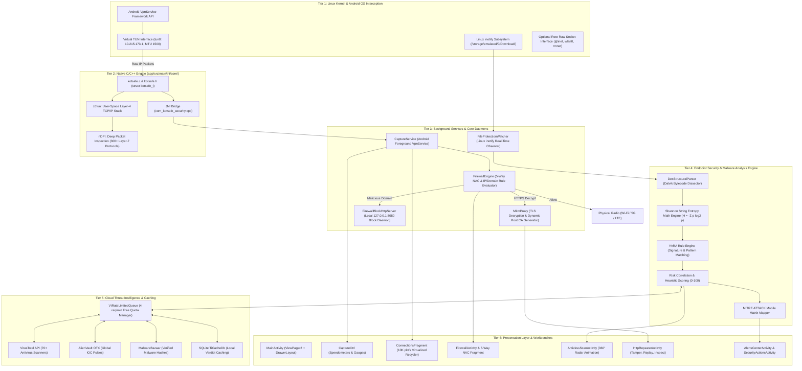
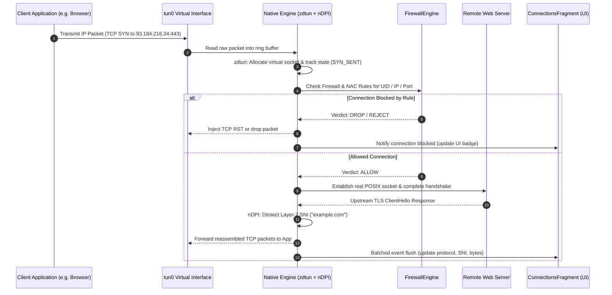

# KotSafe: Complete Project & System Architecture Specification

**KotSafe** is an enterprise-grade mobile security suite, application firewall, offline/cloud malware defense engine, in-app HTTP repeater, and deep network packet inspection platform built specifically for the Android operating system.

KotSafe operates **completely without root privileges** while providing capabilities comparable to desktop enterprise network security tools (such as Wireshark, Suricata, and Burp Suite).

---

## 🏛️ End-to-End 6-Tier System Architecture

KotSafe is structured into six strictly decoupled architectural tiers:

---

## 🔬 Deep Breakdown of Architectural Tiers

### 1. Tier 1: Linux Kernel & Android OS Interception
* **Non-Root Packet Redirection**: Stock Android sandboxes prevent applications from observing other apps' traffic. KotSafe establishes an in-memory loopback TUN interface (`tun0`) configured on virtual subnet `10.215.173.1/32` with an MTU of 1500 bytes using Android's native `VpnService` builder.
* **Transparent Routing**: By configuring routing tables (`0.0.0.0/0` and `::/0`), all device traffic is redirected into KotSafe's user-space file descriptor without requiring kernel modifications or device rooting.
* **Optional Root Mode**: For rooted developer devices or penetration testing rigs, KotSafe can bypass `VpnService` and directly bind raw sockets via `libpcap` to physical interfaces (`wlan0`, `rmnet_data0`, `any`).
* **Filesystem Monitoring (`inotify`)**: KotSafe binds to Linux kernel `inotify` events via Android's `FileObserver` to detect file creation (`CLOSE_WRITE`, `MOVED_TO`) in `/storage/emulated/0/Download/` and sideload paths for instant pre-install malware analysis.

---

### 2. Tier 2: Native C/C++ Engine (`app/src/main/jni/core/`)
At the core of KotSafe is a high-performance native engine written in C and modern C++:
* **Native Entrypoint**: [`kotsafe.c`](file:///home/kali/Documents/KotSafe/app/src/main/jni/core/kotsafe.c), [`kotsafe.h`](file:///home/kali/Documents/KotSafe/app/src/main/jni/core/kotsafe.h), managing state structure `struct kotsafe_t`.
* **`zdtun` User-Space TCP/IP Stack**:
  * Implements RFC 793 (TCP) and RFC 768 (UDP) state machines in user-space.
  * Reassembles fragmented IP packets and tracks TCP sliding windows, sequence numbers, acknowledgments, and retransmissions.
  * Maintains virtual socket mappings that translate incoming packets into standard outbound POSIX sockets.
* **`nDPI` Deep Packet Inspection**:
  * Embedded ntop `nDPI` engine classifying 300+ Layer-7 protocols (DoH, TLS, QUIC, BitTorrent, WireGuard, HTTP, SSH, DNS).
  * Extracts metadata such as TLS Server Name Indication (SNI), cipher suites, HTTP User-Agents, and Host headers without decrypting payloads.
* **JNI Bridge Layer**:
  * Efficient zero-copy ring buffers and batched JNI callbacks pass socket state transitions to Java without triggering garbage collection pauses.

---

### 3. Tier 3: Background Services & Core Daemons
* **`CaptureService.java`**: Android Foreground Service running with `FOREGROUND_SERVICE_TYPE_SYSTEM_EXEMPTED` or `SPECIAL_USE`, displaying persistent system notifications to prevent OEM battery-killer task terminations.
* **`FirewallEngine` (Rule Evaluation Hierarchy)**:
  Every connection passing through KotSafe is subjected to a strict 5-stage evaluation:
  1. **Whitelist Overrides**: Explicit rules allowing critical system services or user-approved domains.
  2. **Threat Intelligence / Malicious Blacklists**: Checks against known malicious IPs, malware domains, and phishing feeds.
  3. **5-Way Per-App NAC**: Evaluates application network permissions across Wi-Fi, 5G/Mobile, Roaming, Screen-Off background state, and LAN isolation.
  4. **Custom Blacklist Rules**: User-defined CIDR IP blocks, domain regex patterns, and port restrictions.
  5. **Default Policy**: Fallback to Default-Allow or Default-Deny based on current mode.
* **`MitmProxy` & TLS Decryption Engine**:
  * Generates an internal X.509 Root CA certificate (`kotsafe-ca.crt`).
  * Intercepts TLS ClientHello handshakes, dynamically synthesizes end-entity certificates signed by the local CA, and proxies encrypted HTTP/1.1 and HTTP/2 connections.
* **`FirewallBlockHttpServer.java`**:
  * Embedded loopback HTTP web daemon listening on `127.0.0.1:8080`.
  * Intercepts browser traffic destined for blocked domains and serves an interactive, responsive HTML5/CSS3 dark-mode security page explaining the threat and offering tokenized unblock actions.
* **`FileProtectionWatcher.java`**:
  * Watches download directories in background and immediately dispatches new APKs or downloaded files to Tier 4 for analysis.

---

### 4. Tier 4: Endpoint Security & Malware Analysis Engine
* **`DexStructuralParser`**:
  * Reads Dalvik Executable (`.dex`) binary structures directly without relying on external decompilers.
  * Parses header magic, string pools, type lists, and method bytecode.
  * Flags dangerous Dalvik API call signatures: `Runtime.getRuntime().exec()`, `DexClassLoader`, `getSubscriberId()`, `sendTextMessage()`, and dynamic reflection abuse.
* **Shannon String Entropy Mathematics**:
  * Calculates information entropy across string tables and data sections:
    $$H(X) = -\sum_{i=1}^{n} P(x_i) \log_2 P(x_i)$$
  * Values approaching $H \ge 7.20$ indicate strong cryptographic packing, obfuscation, or payload encryption typical of modern mobile trojans.
* **`YaraEngine`**:
  * Compiles and evaluates high-performance YARA pattern matching rules against raw binary streams for known spyware, Pegasus indicators, and RAT signatures.
* **`RiskCorrelationEngine` & Heuristic Scoring**:
  * Aggregates signals (entropy, permissions, DEX bytecode, cloud reputation) into an objective 0–100 risk score.
* **`MitreAttackMapper`**:
  * Automatically maps detected behaviors to the official **MITRE ATT&CK Mobile Matrix** (e.g., T1407: Hijack Execution Flow, T1417: Input Capture, T1430: Location Tracking).

---

### 5. Tier 5: Cloud Threat Intelligence & Caching
* **SOC Cloud Feed Integration**:
  * **VirusTotal API v3**: Queries over 70 commercial antivirus scanners for file hashes (SHA-256) and domain reputations.
  * **AlienVault OTX API**: Checks domains, IPs, and hashes against global threat intelligence "Pulses".
  * **MalwareBazaar API**: Cross-references hashes against verified malware samples provided by Abuse.ch.
* **`VtRateLimitedQueue`**:
  * Manages asynchronous rate-limiting (e.g., free-tier 4 requests/min, 500 requests/day for VirusTotal) using a priority queue with token bucket scheduling.
* **`TiCacheDb` (Local SQLite Cache)**:
  * Stores verdicts, malicious threat tags, and TTL timestamps locally to eliminate redundant network queries and preserve API quotas.

---

### 6. Tier 6: Presentation Layer & User Workbenches
* **`MainActivity.java`**: Hosts the core `ViewPager2` swiping between the `CaptureCtrl` dashboard and the `ConnectionsFragment` stream, flanked by the slide-out navigation drawer.
* **High-Throughput Packet Recycler (`ConnectionsAdapter.java`)**:
  * Handles 10,000+ packets/sec with zero frame drops ("jank") through 50ms ring-buffer batching, `DiffUtil` payload updates, and LRU icon caching.
* **`FirewallActivity.java` & `NetworkAccessControlFragment.java`**:
  * Interactive 5-way matrix providing instant per-app toggle control over Wi-Fi, Cellular, Roaming, Screen-off, and LAN.
* **`AntivirusScanActivity.java`**:
  * Cyberpunk radar visualizer with concentric target rings and 360° holographic sweep animations (`laser_sweep.xml`).
* **`HttpRepeaterActivity.java`**:
  * Mobile Burp-style workbench allowing raw HTTP/HTTPS request tampering, method switching, custom header injection, and instant replay.
* **`AlertsCenterActivity.java` & `SecurityActionsActivity.java`**:
  * Unified incident response center for alert triaging, rule administration, and one-tap file quarantine/shredding.

---

## 📊 End-to-End Packet Processing Pipeline

---

## 🔒 Security, Privacy & Performance Guarantees

1. **Zero External Telemetry**: KotSafe contains zero proprietary trackers, analytics engines, or external advertising SDKs.
2. **Local Data Sovereignty**: All packet processing, protocol classification, Dalvik DEX parsing, entropy mathematics, and logging occur strictly on-device.
3. **Hardware Battery Conservation**:
   * All vector animations and sweep renderers automatically halt during `onStop()` / `onPause()`.
   * UI DiffUtil calculations suspend when the device screen locks (`Intent.ACTION_SCREEN_OFF`), allowing native packet capture to run with minimal battery consumption.
4. **Open-Source Transparency**: 100% open-source codebase licensed under the GNU General Public License v3.0 (GPL-3.0).

---

[⬅️ Back to Master Design Index](README.md)
