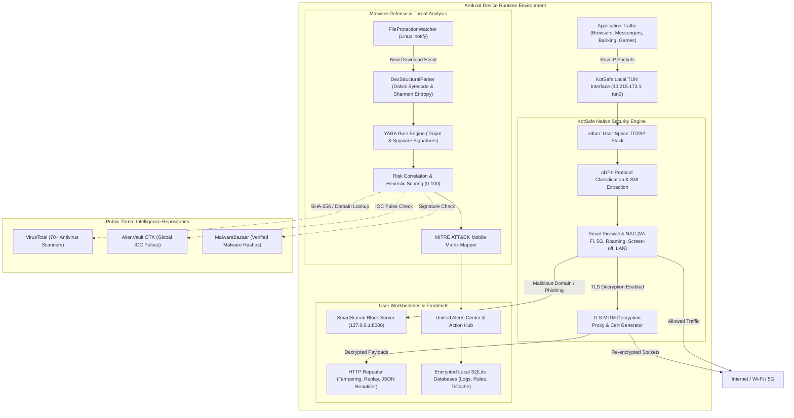

# KotSafe: The Ultimate Comprehensive User & Security Guide

Welcome to the official documentation and comprehensive user manual for **KotSafe** — an advanced open-source Android security suite, application firewall, offline/cloud malware defense engine, in-app HTTP repeater, and deep network packet inspection platform.

---

## 📑 Complete Table of Contents

| Chapter | Focus Area | Key Topics & Capabilities |
| :--- | :--- | :--- |
| [**Master System Architecture**](PROJECT_ARCHITECTURE.md) | End-to-End Core Blueprint | Complete 6-tier system architecture: Linux kernel/TUN interception, native C/C++ engine (`kotsafe.c`), `zdtun` L4 stack, `nDPI`, background daemons, malware engine, threat intel, and workbenches. |
| [**Chapter 1: Architecture & Initial Setup**](01_ARCHITECTURE_AND_SETUP.md) | Core Foundations | Non-root VPN simulation, `zdtun` L4 TCP/IP stack, `nDPI` protocol dissection, permission matrix, enterprise ADB automation, and first capture. |
| [**Chapter 2: Smart Firewall & NAC**](02_FIREWALL_AND_NETWORK_ACCESS_CONTROL.md) | Network Defense | Master firewall, granular Per-App NAC (Wi-Fi, 5G, Roaming, Screen-off, LAN block), rule hierarchy, Whitelist vs Blacklist, and SmartScreen interception (`127.0.0.1:8080`). |
| [**Chapter 3: Antivirus & Malware Defense**](03_ANTIVIRUS_AND_MALWARE_DEFENSE.md) | Endpoint Security | Quick vs Full Deep Scan, real-time `inotify` File Protection Watcher, APK Pre-Install Scanner, Dalvik `DexStructuralParser`, Shannon entropy, YARA rules, and MITRE ATT&CK Mobile. |
| [**Chapter 4: Threat Intelligence API Setup**](04_THREAT_INTELLIGENCE_API_SETUP.md) | Cloud SOC Feeds | Step-by-step API key setup for **VirusTotal**, **AlienVault OTX**, and **MalwareBazaar**; rate-limiting queue (`VtRateLimitedQueue`), SQLite caching (`TiCacheDb`), and diagnostics. |
| [**Chapter 5: TLS Decryption & Inspection**](05_TLS_DECRYPTION_AND_INSPECTION.md) | Deep Packet Inspection | In-app MITM decryption proxy, CA certificate installation (Android 7–15), Network Security Config bypass, live Wireshark streaming (`PCAP-over-IP`), SSLKEYLOGFILE, and HAR export. |
| [**Chapter 6: In-App HTTP Repeater & Analysis**](06_HTTP_REPEATER_AND_ANALYSIS.md) | Penetration Testing | On-device Burp-style repeater, request tampering, method switching, custom header injection, JSON formatting, latency benchmarks, and mobile API security workflows (BOLA/IDOR). |
| [**Chapter 7: App Permissions & Privacy Audit**](07_APP_PERMISSIONS_AND_PRIVACY.md) | Privilege Auditing | Dangerous permission categorization, overlay (`SYSTEM_ALERT_WINDOW`) & accessibility abuse detection, real-time `AppInstallMonitor`, and one-tap permission revocation. |
| [**Chapter 8: Alerts Center & Remediation**](08_ALERTS_CENTER_AND_REMEDIATION.md) | Incident Response | Central SOC console (`AlertsCenterActivity`), Action Center (`SecurityActionsActivity`), forensic evidence inspection (`EvidenceDetailActivity`), and one-tap file shredding/quarantine. |
| [**Chapter 9: Troubleshooting & Backup**](09_TROUBLESHOOTING_AND_BACKUP.md) | Administration & Ops | OEM battery optimization bypasses (Samsung, Xiaomi, OnePlus), storage retention management (`StorageManagementActivity`), JSON configuration backup/restore, and VPN coexistence. |
| [**DoH & DNSCrypt Guide**](../docs/doh_dnscrypt_guide.md) | DNS Privacy & Cryptography | Hardened DNS-over-HTTPS (RFC 8484), DNSCrypt stamp configuration, dnscrypt-proxy integration, preset benchmark speed tests, and DNS leak prevention. |
| [**Wireshark Dump Extensions**](../docs/wireshark_dump_extensions.md) | Forensics & Packet Analysis | Display Android App Name, UID, and Package in Wireshark; PCAPng custom block parsing, Lua post-dissector (`kotsafe.lua`), custom columns, and DSB TLS decryption. |
| [**Frontend Architecture & UI System**](FRONTEND_ARCHITECTURE.md) | UI/UX & Presentation | Deep architecture breakdown: `MainActivity`, `ViewPager2`, real-time DiffUtil packet stream, 5-way NAC, Antivirus radar UI, HTTP Repeater, Material Design 3 system, and full screenshot gallery. |

---

## 🛡️ Comprehensive Capability Matrix

| Feature / Capability | Standard Android VPNs | Traditional Mobile AV | Legacy Base Capture | **KotSafe Enterprise Suite** |
| :--- | :---: | :---: | :---: | :---: |
| **No-Root Packet Capture** | ❌ No | ❌ No | ✅ Yes | ✅ **Yes** |
| **Deep Protocol Dissection** | ❌ No | ❌ No | ⚠️ Generic L4 | ✅ **Yes (JA4/JA4+ & DPI)** |
| **Per-App Network Access Control (NAC)** | ⚠️ Limited | ❌ No | ⚠️ Basic | ✅ **Yes (5-Way Granular)** |
| **Screen-Off Background Leak Blocker** | ❌ No | ❌ No | ❌ No | ✅ **Yes (`NetworkStateMonitor`)** |
| **Browser SmartScreen Block Page** | ❌ No | ⚠️ Web only | ❌ No | ✅ **Yes (Local `127.0.0.1:8080`)** |
| **Real-Time `inotify` Download Watcher** | ❌ No | ⚠️ Periodic | ❌ No | ✅ **Yes (`FileProtectionWatcher`)** |
| **Pre-Install Dalvik DEX Bytecode Parser** | ❌ No | ⚠️ Cloud only | ❌ No | ✅ **Yes (`DexStructuralParser`)** |
| **Shannon String Entropy Mathematics** | ❌ No | ❌ No | ❌ No | ✅ **Yes (Heuristic Weighting)** |
| **Multi-Engine Cloud Threat Intelligence** | ❌ No | ⚠️ Proprietary | ❌ No | ✅ **Yes (VirusTotal, OTX, Bazaar)** |
| **MITRE ATT&CK Matrix for Mobile** | ❌ No | ❌ No | ❌ No | ✅ **Yes (Full Tactic Mapping)** |
| **In-App HTTP Tamper & Repeater** | ❌ No | ❌ No | ❌ No | ✅ **Yes (`HttpRepeaterActivity`)** |
| **Live Wireshark Streaming (`PCAP-over-IP`)**| ❌ No | ❌ No | ✅ Yes | ✅ **Yes** |
| **SSLKEYLOGFILE TLS Decryption Export** | ❌ No | ❌ No | ✅ Yes | ✅ **Yes** |
| **Unified Alerts & Action Center** | ❌ No | ⚠️ Basic | ❌ No | ✅ **Yes (`AlertsCenterActivity`)** |
| **JSON Configuration Backup & Restore** | ❌ No | ❌ No | ⚠️ Limited | ✅ **Yes (`SettingsBackupHandler`)** |

---

## 🎨 End-to-End Security Architecture

---

## 🚀 Quick Start in 60 Seconds

### Step 1: Launch and Authorize
1. Launch **KotSafe**.
2. Tap the large central **Start** button.
3. Accept the Android VPN prompt (KotSafe runs strictly on local loopback `10.215.173.1` and does not transmit data to external VPN servers).

### Step 2: Turn on Defense
1. Switch to the **Firewall** tab and toggle the **Master Switch ON**.
2. In **Antivirus**, tap **Quick Scan** to immediately verify existing downloads.

### Step 3: Connect Threat Intelligence Feeds
1. Open **Settings** $\rightarrow$ **Threat Intelligence & API Keys**.
2. Follow our [**Chapter 4 Setup Guide**](04_THREAT_INTELLIGENCE_API_SETUP.md) to add your free VirusTotal, OTX, or MalwareBazaar keys.

---

## 🔒 Privacy & Data Sovereignty Guarantees

* **Zero Telemetry**: KotSafe contains zero third-party analytics trackers (No Google Analytics, No Firebase, No Flurry, No Adjust).
* **Local Processing**: All packet dissections, heuristic calculations, and log storage are executed directly on your device CPU and local SQLite storage.
* **Open Source**: Complete transparency with source code publicly auditable under the GPL-3.0 license.

---

[➡️ Begin with Chapter 1: Architecture & Setup](01_ARCHITECTURE_AND_SETUP.md)
