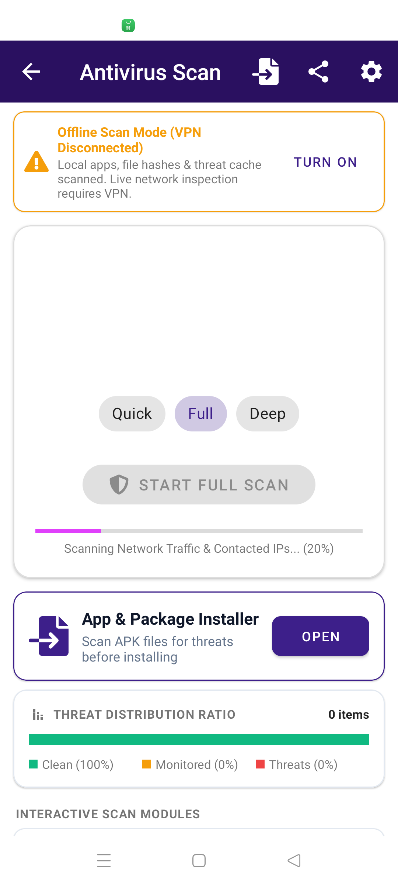
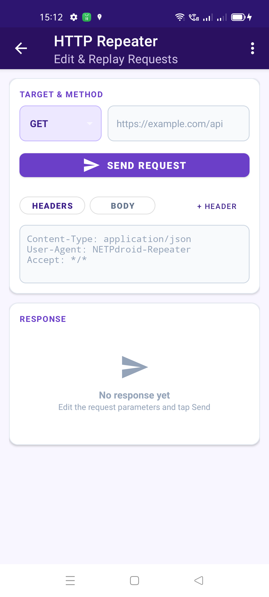
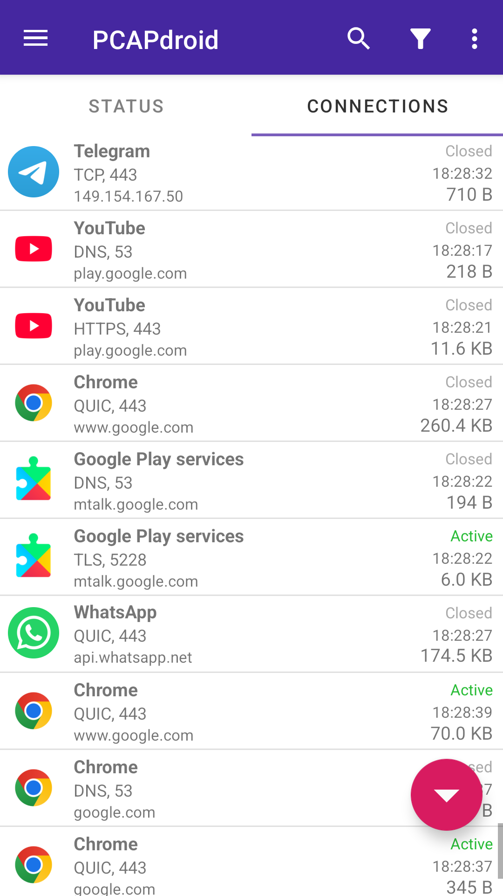
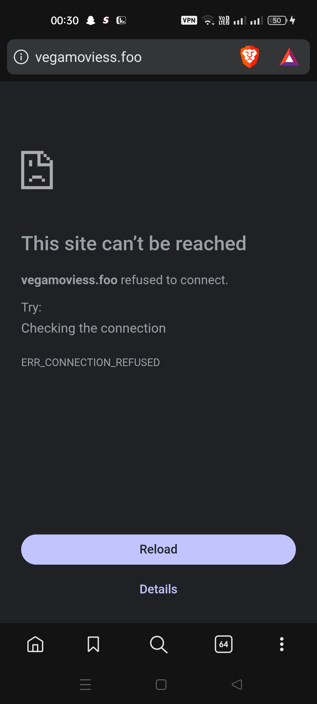
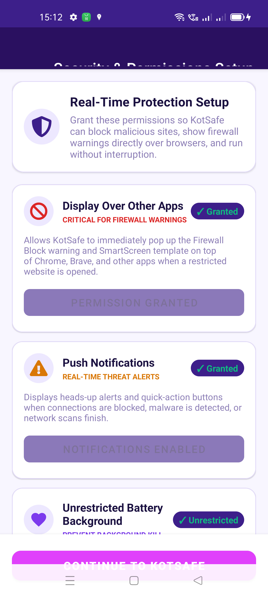
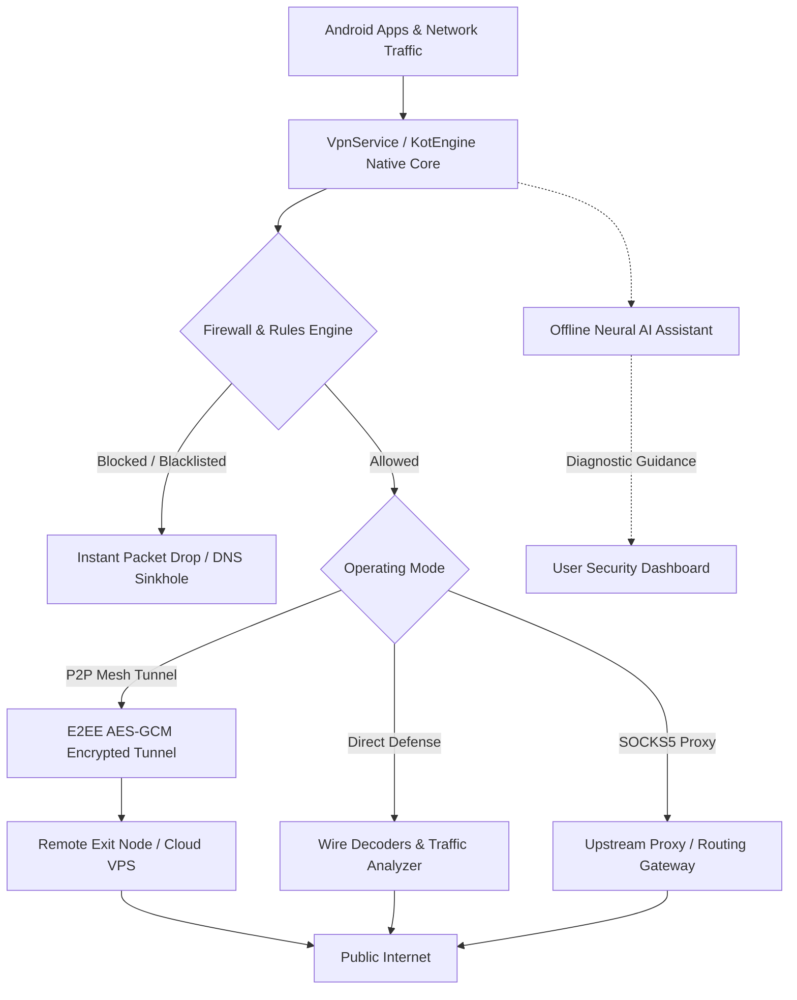
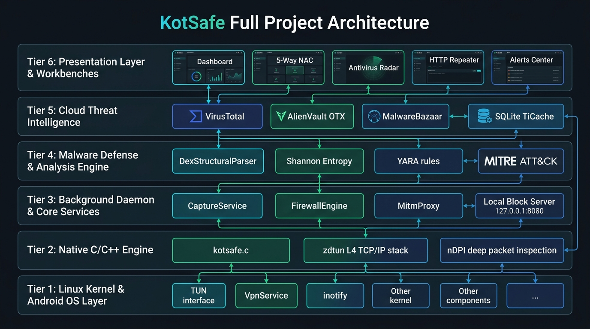

# KotSafe — Sovereign Android Cyber Security & Zero-Trust Defense Suite

<p align="center">
  
</p>

<p align="center">
  <b>Enterprise-Grade Zero-Trust Mobile Defense, P2P Encrypted Mesh, SOCKS5 Proxy Router, No-Root Packet Firewall & Offline AI Assistant for Android</b>
</p>

<p align="center">
  <a href="LICENSE"></a>
  <a href="SECURITY.md"></a>
  <a href="https://github.com/SurajAdhikari0/KotSafe/actions/workflows/ci.yml"></a>
  <a href="#-building-the-android-app"></a>
  <a href="#-turnkey-server-deployment"></a>
  <a href="#-privacy--zero-telemetry-guarantee"></a>
  <a href="#-offline-ai-assistant"></a>
  <a href="https://github.com/SurajAdhikari0/KotSafe/releases/latest"></a>
  <a href="https://github.com/SurajAdhikari0/KotSafe/issues"></a>
</p>

---

> [!WARNING]
> ### 🚧 Project Under Active Construction — Expect Bugs & Rapid Changes
> **KotSafe is currently undergoing heavy architectural modernization and rapid active development.**  
> Because cutting-edge native packet engines (KotEngine C++/JNI), on-device neural AI models, and P2P mesh routing protocols are continuously evolving:
> * **Expect bugs, instability, and rough edges:** You may encounter crashes, performance quirks, or incomplete features in current builds.
> * **Not recommended for mission-critical production environments** without prior isolated testing.
> * **Found a bug?** Please submit detailed crash traces, logs, or reproduction steps via [GitHub Issues](https://github.com/SurajAdhikari0/KotSafe/issues). Community contributions and feedback are greatly appreciated!

---

## 📥 Direct APK Downloads

You can download official signed KotSafe APK binaries directly from GitHub Releases:

<p align="center">
  <a href="https://github.com/SurajAdhikari0/KotSafe/releases/latest/download/KotSafe-fullPower-release.apk">
    
  </a>
  &nbsp;&nbsp;&nbsp;
  <a href="https://github.com/SurajAdhikari0/KotSafe/releases/latest/download/KotSafe-standard-release.apk">
    
  </a>
</p>

<p align="center">
  <a href="https://github.com/SurajAdhikari0/KotSafe/releases/latest"><b>👉 Browse All Releases, Debug Builds & Release Notes on GitHub</b></a>
</p>

### ⚖️ Edition Comparison & Differentiation

Choose the edition that best matches your security posture and device requirements:

| Security Capability | ⚡ Standard Edition (`standard`) | 🛡️ Full-Power Edition (`fullPower`) |
| :--- | :---: | :---: |
| **Intelligent No-Root Packet Firewall & NAC** | ✅ Full | ✅ Full |
| **Offline Neural AI Assistant (Qwen / SmolLM)** | ✅ Full | ✅ Full |
| **P2P Encrypted Mesh Tunneling & Exit Nodes** | ✅ Full | ✅ Full |
| **SOCKS5 & Transparent Smart Proxy Router** | ✅ Full | ✅ Full |
| **DoH / DNSCrypt Sinkhole Engine** | ✅ Full | ✅ Full |
| **TLS 1.3 / HTTPS Wire Decryption & PCAP Dump** | ✅ Full | ✅ Full |
| **Pre-Install APK Inspector & Sideload Sandbox** | ❌ *(Omitted)* | ✅ **Active** (`REQUEST_INSTALL_PACKAGES`) |
| **Browser Address Bar Real-Time Phishing Guard** | ❌ *(Omitted)* | ✅ **Active** (`BrowserAccessibilityService`) |
| **Notification & SMS Smishing/Link Protector** | ❌ *(Omitted)* | ✅ **Active** (`PhishingNotificationListener`) |
| **Anti-Snooping Screen Overlay (`FLAG_SECURE`)** | ❌ *(Omitted)* | ✅ **Active** (`ScreenshotBlockOverlayService`) |
| **Enterprise Work Profile Isolation** | ❌ *(Omitted)* | ✅ **Active** (`INTERACT_ACROSS_USERS`) |
| **Deep Storage Threat & Forensics Scanner** | ❌ *(Scoped)* | ✅ **Active** (`MANAGE_EXTERNAL_STORAGE`) |
| **Recommended Target** | General users, baseline permission devices | Power users, security researchers, enterprise defense |

> [!TIP]
> **Which edition should I choose?**
> * **Download Full-Power (Recommended)** if you want complete, uncompromised endpoint protection without Play Store restrictions — including real-time browser URL phishing blocking, SMS malicious link detection, APK installer scanning before installation, and screenshot snooping protection.
> * **Download Standard** if you only require the core packet firewall, VPN tunneling, DNS filtering, and offline AI assistant using standard, minimal Android permissions.

---

## 📸 Visual Showcase & Interface

<p align="center">
  
  
  
</p>

<p align="center">
  
  
  
</p>

---

## 🌟 Key Architectural Features

### 🛡️ 1. Zero-Trust Security & Device Posture
* **Defense Readiness Scoring**: Instant evaluation of operating state across kernel firewall rules, background isolation, encrypted DNS, and rootless TLS interception.
* **Continuous Anomaly Telemetry**: Real-time detection of periodic C2 beaconing, port scanning, abnormal packet floods, and rogue Wi-Fi access points.
* **SmartScreen Action Center**: Heads-up notifications when high-risk sockets or suspicious payloads are dropped, with one-tap mitigation and temporary/permanent whitelisting.

### 🌐 2. P2P Mesh Tunneling & Personal Gateway
* **Turn Any Device into a Private VPN**: Route protected traffic through your home computer, another phone, or a self-hosted cloud VPS using peer-to-peer tunnels.
* **End-to-End Cryptography**: Authenticated AEAD ciphers (AES-256-GCM / ChaCha20-Poly1305) with ephemeral ECDH key exchange.
* **Zero Open Ports Required**: Full NAT traversal over STUN/TURN, WebSockets, or Cloudflare Quick Tunnels to bypass restrictive carrier CGNAT and 5G firewalls.
* **Selective App Routing**: Tunnel entire device traffic or isolate specific sensitive applications through designated exit nodes.

### 🔀 3. SOCKS5 & Inbound/Outbound Smart Proxy
* **Multi-Mode Network Router**: Supports SOCKS5 client proxying, HTTP upstream proxies, and transparent packet encapsulation.
* **Smart UPnP & NAT-PMP Port Mapping**: Automated router port forward negotiation with custom external port bindings.
* **Zero-Root Local Redirection**: Seamlessly chains into external proxy clients such as Shadowsocks, v2rayNG, or custom corporate gateways.

### 🔥 4. No-Root Intelligent Firewall & NAC
* **Per-App Network Rules**: Restrict internet access, cellular usage, or background background data leakage on an app-by-app basis.
* **Kernel-Level Packet Interception**: Powered by KotEngine high-throughput C++/JNI native core with zero battery overhead.
* **Malicious Domain & Telemetry Shield**: Real-time DNS sinkhole responder dropping connections to known C2 servers, malware distributors, and tracking domains.
* **Emergency Lockdown Mode**: Single-tap kill switch to immediately terminate all non-whitelisted egress connections during an active incident.

### 🧠 5. Offline AI Assistant & Neural Heuristics
* **100% Private Offline Brain**: On-device neural heuristic reasoning using quantized models (Qwen 2.5 0.5B, SmolLM 135M, Google Gemma 2B) running entirely in local memory.
* **Security Triage & Posture Tuning**: Ask conversational questions, audit suspicious connection payloads, evaluate split APK signatures, or diagnose connectivity bottlenecks without sending single byte off-device.
* **Flexible Cloud AI Handoff (Optional)**: Support for bring-your-own API key (Google Gemini, OpenAI ChatGPT, Anthropic Claude, or local Ollama endpoints) with granular permission toggles.

### 🔍 6. Deep Packet Inspection & Wire Decoders
* **TLS 1.3 / HTTPS Decryption**: In-memory TLS dissection via user-trusted root CA for inspecting HTTP/2, WebSockets, and encrypted APIs.
* **Standard PCAP / PCAPNG Dump**: Nanosecond-accurate packet dumps compatible with Wireshark and NetworkMiner, enriched with Android package and process metadata.
* **HTTP Repeater**: Built-in security auditor to inspect, modify, and re-send raw HTTP requests directly from mobile.

---

## 🏗️ System Architecture

### High-Level Engineering Pipeline


### Modular Project Architecture
<p align="center">
  
</p>

### Network Access Control (NAC) & Firewall Structure
<p align="center">
  
</p>

---

## 🧭 Repository Layout

```
KotSafe/
├── app/                           # 📱 Core Android Application (Java, Kotlin, C++ JNI)
│   ├── src/main/java/             # High-performance packet engine, AI, IPS & P2P
│   │   └── com/kotsafe/security/
│   │       ├── activities/        # UI dashboards, onboarding, settings, and monitors
│   │       ├── ai/                # On-device AI engine, neural models & prompt triage
│   │       ├── decoders/          # TLS wire decoders, gRPC, DoH, JA3 fingerprinter
│   │       ├── ips/               # Intrusion Prevention System & packet filter
│   │       ├── p2p/               # E2EE mesh relay, WebSockets, tunnel cipher
│   │       ├── model/             # Connections database, IOC catalog, threat scoring
│   │       └── vpn/               # VpnService integration & virtual NIC tun router
│   ├── src/main/jni/              # C++ native core (KotEngine, Zstandard, PCAP parser)
│   └── src/main/res/              # Tactical dark theme, icons, layouts, and translations
│
├── screenshots/                   # 📸 Architecture diagrams, UI captures & flowcharts
│
└── submodules/                    # ⚡ Optimized Native Libraries
    ├── MaxMind-DB-Reader-java/    # Offline GeoIP and ASN database resolver
    └── zstd/                      # High-speed Zstandard compression engine
```

---

## 📱 Building the Android App

### Prerequisites
* **Android Studio Ladybug** (or newer)
* **Android SDK 34+** (API 24 minimum)
* **Android NDK** (version 25+)
* **CMake 3.22+**

### Command-Line Build
```bash
# Clone with all submodules:
git clone --recursive https://github.com/SurajAdhikari0/KotSafe.git
cd KotSafe

# Compile Standard Edition APK:
./gradlew assembleStandardDebug
# Output: app/build/outputs/apk/standard/debug/KotSafe-standard-debug.apk

# Compile Full-Power Edition APK:
./gradlew assembleFullPowerDebug
# Output: app/build/outputs/apk/fullPower/debug/KotSafe-fullPower-debug.apk
```

---

## 🔒 Privacy & Zero-Telemetry Guarantee

1. **100% On-Device Processing**: Sockets, payloads, and threat analysis remain strictly on your physical device. KotSafe operates without remote analytics or advertising tracking SDKs.
2. **Sovereign Key Storage**: All AES-GCM encryption keys, DoH credentials, and private CA certificates are stored securely in Android SharedPreferences / Encrypted Keystore on your device.
3. **Auditable Codebase**: Released under the copyleft **GNU General Public License v3.0**, ensuring full transparency and user sovereignty.

---

## 🤝 Contributing & Security Research

KotSafe is a community-driven, sovereign mobile security project. We actively welcome and invite **security researchers, malware analysts, reverse engineers, cryptographers, and network engineers** to collaborate and contribute:

### 🛡️ Areas Where Security Researchers Can Help:
* **Malware Indicators & C2 Patterns**: Contribute known command-and-control (C2) domains, IP blocklists, and anomalous beaconing signatures.
* **JA3 / JA3S TLS Fingerprints**: Expand the built-in JA3 database to detect mobile banking trojans, spyware, and evasive C2 implants.
* **Protocol Parsers & Wire Decoders**: Help improve dissection of HTTP/2, HTTP/3 (QUIC), gRPC, DoH, and proprietary IoT telemetry protocols.
* **Zero-Trust & Kernel Hardening**: Audit the native C++/JNI packet engine (KotEngine), memory safety, and VPN routing boundary checks.
* **AI & Heuristic Triage**: Refine on-device neural prompts and heuristic scoring models to reduce false positives in enterprise workflows.
* **Vulnerability Disclosure & Bug Reports**: Discovered a security flaw or edge-case bug? Please report it via [GitHub Issues](https://github.com/SurajAdhikari0/KotSafe/issues) or submit a Pull Request.

---

## 👤 Author & Project Maintainer

* **Suraj Adhikari** — Founder, Lead Architect & Security Systems Engineer
  * GitHub: [@SurajAdhikari0](https://github.com/SurajAdhikari0)

---

## 📜 License

KotSafe is free software: you can redistribute it and/or modify it under the terms of the **GNU General Public License as published by the Free Software Foundation, either version 3 of the License, or (at your option) any later version (GPLv3+)**.

This program is distributed in the hope that it will be useful, but WITHOUT ANY WARRANTY; without even the implied warranty of MERCHANTABILITY or FITNESS FOR A PARTICULAR PURPOSE. See the [GNU General Public License (LICENSE)](LICENSE) for full details.

Copyright (c) 2026 Suraj Adhikari. All rights reserved.


