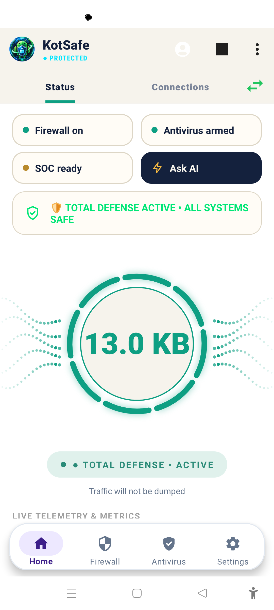
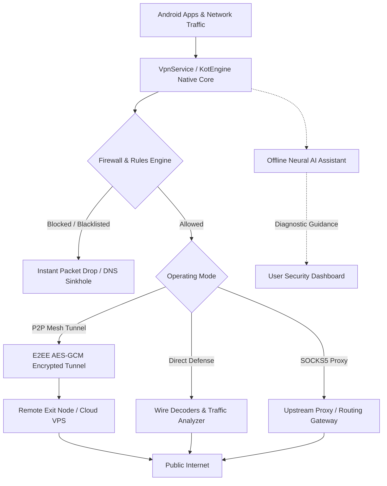

# KotSafe — Sovereign Android Cyber Security & Zero-Trust Defense Suite

<p align="center">
  
</p>

<p align="center">
  <b>Enterprise-Grade Zero-Trust Mobile Defense, P2P Encrypted Mesh, SOCKS5 Proxy Router, No-Root Packet Firewall & Offline AI Assistant for Android</b>
</p>

<p align="center">
  <a href="LICENSE"></a>
  <a href="#-building-the-android-app"></a>
  <a href="#-turnkey-server-deployment"></a>
  <a href="#-privacy--zero-telemetry-guarantee"></a>
  <a href="#-offline-ai-assistant"></a>
</p>

---

## 📸 Visual Showcase & Interface

<p align="center">
  
  
  
</p>

<p align="center">
  
  
  
</p>

---

## 🌟 Key Architectural Features

### 🛡️ 1. Zero-Trust Security & Device Posture
* **Defense Readiness Scoring**: Instant evaluation of operating state across kernel firewall rules, background isolation, encrypted DNS, and rootless TLS interception.
* **Continuous Anomaly Telemetry**: Real-time detection of periodic C2 beaconing, port scanning, abnormal packet floods, and rogue Wi-Fi access points.
* **SmartScreen Action Center**: Heads-up notifications when high-risk sockets or suspicious payloads are dropped, with one-tap mitigation and temporary/permanent whitelisting.

### 🌐 2. P2P Mesh Tunneling & Personal Gateway
* **Turn Any Device into a Private VPN**: Route protected traffic through your home computer, another phone, or a self-hosted cloud VPS using peer-to-peer tunnels.
* **End-to-End Cryptography**: Authenticated AEAD ciphers (AES-256-GCM / ChaCha20-Poly1305) with ephemeral ECDH key exchange.
* **Zero Open Ports Required**: Full NAT traversal over STUN/TURN, WebSockets, or Cloudflare Quick Tunnels to bypass restrictive carrier CGNAT and 5G firewalls.
* **Selective App Routing**: Tunnel entire device traffic or isolate specific sensitive applications through designated exit nodes.

### 🔀 3. SOCKS5 & Inbound/Outbound Smart Proxy
* **Multi-Mode Network Router**: Supports SOCKS5 client proxying, HTTP upstream proxies, and transparent packet encapsulation.
* **Smart UPnP & NAT-PMP Port Mapping**: Automated router port forward negotiation with custom external port bindings.
* **Zero-Root Local Redirection**: Seamlessly chains into external proxy clients such as Shadowsocks, v2rayNG, or custom corporate gateways.

### 🔥 4. No-Root Intelligent Firewall & NAC
* **Per-App Network Rules**: Restrict internet access, cellular usage, or background background data leakage on an app-by-app basis.
* **Kernel-Level Packet Interception**: Powered by KotEngine high-throughput C++/JNI native core with zero battery overhead.
* **Malicious Domain & Telemetry Shield**: Real-time DNS sinkhole responder dropping connections to known C2 servers, malware distributors, and tracking domains.
* **Emergency Lockdown Mode**: Single-tap kill switch to immediately terminate all non-whitelisted egress connections during an active incident.

### 🧠 5. Offline AI Assistant & Neural Heuristics
* **100% Private Offline Brain**: On-device neural heuristic reasoning using quantized models (Qwen 2.5 0.5B, SmolLM 135M, Google Gemma 2B) running entirely in local memory.
* **Security Triage & Posture Tuning**: Ask conversational questions, audit suspicious connection payloads, evaluate split APK signatures, or diagnose connectivity bottlenecks without sending single byte off-device.
* **Flexible Cloud AI Handoff (Optional)**: Support for bring-your-own API key (Google Gemini, OpenAI ChatGPT, Anthropic Claude, or local Ollama endpoints) with granular permission toggles.

### 🔍 6. Deep Packet Inspection & Wire Decoders
* **TLS 1.3 / HTTPS Decryption**: In-memory TLS dissection via user-trusted root CA for inspecting HTTP/2, WebSockets, and encrypted APIs.
* **Standard PCAP / PCAPNG Dump**: Nanosecond-accurate packet dumps compatible with Wireshark and NetworkMiner, enriched with Android package and process metadata.
* **HTTP Repeater**: Built-in security auditor to inspect, modify, and re-send raw HTTP requests directly from mobile.

---

## 🏗️ System Architecture

### High-Level Engineering Pipeline


### Modular Project Architecture
<p align="center">
  
</p>

### Network Access Control (NAC) & Firewall Structure
<p align="center">
  
</p>

---

## 🧭 Repository Layout

```
KotSafe/
├── app/                           # 📱 Core Android Application (Java, Kotlin, C++ JNI)
│   ├── src/main/java/             # High-performance packet engine, AI, IPS & P2P
│   │   └── com/kotsafe/security/
│   │       ├── activities/        # UI dashboards, onboarding, settings, and monitors
│   │       ├── ai/                # On-device AI engine, neural models & prompt triage
│   │       ├── decoders/          # TLS wire decoders, gRPC, DoH, JA3 fingerprinter
│   │       ├── ips/               # Intrusion Prevention System & packet filter
│   │       ├── p2p/               # E2EE mesh relay, WebSockets, tunnel cipher
│   │       ├── model/             # Connections database, IOC catalog, threat scoring
│   │       └── vpn/               # VpnService integration & virtual NIC tun router
│   ├── src/main/jni/              # C++ native core (KotEngine, Zstandard, PCAP parser)
│   └── src/main/res/              # Tactical dark theme, icons, layouts, and translations
│
├── server_oracle_and_vps/         # ☁️ Turnkey Signaling & P2P Relay Server
│   ├── signaling-server/          # High-concurrency Node.js WebSocket relay
│   ├── docker-compose.yml         # Containerized Coturn STUN/TURN + Signaling
│   ├── docker-compose.tunnel.yml  # Cloudflare Quick Tunnel automated stack
│   ├── turnserver.conf            # Hardened Coturn NAT traversal configuration
│   └── install.sh                 # 1-Click installer for Oracle Cloud, AWS, DigitalOcean
│
├── standalone_p2p_vpn_module/     # 🔌 Reusable Standalone P2P Mesh Module
│   ├── android/                   # Standalone Android tunnel classes & routing
│   ├── server/                    # Standalone binary relay & Dockerfile
│   └── reference-client/          # Headless test client & exit gateway
│
├── KotSafe_User_Guide/            # 📚 Detailed Guides & Security Manuals
│   ├── 01_ARCHITECTURE_AND_SETUP.md
│   ├── 02_FIREWALL_AND_NETWORK_ACCESS_CONTROL.md
│   ├── 03_ANTIVIRUS_AND_MALWARE_DEFENSE.md
│   ├── 04_THREAT_INTELLIGENCE_API_SETUP.md
│   ├── 05_TLS_DECRYPTION_AND_INSPECTION.md
│   └── ...
│
└── submodules/                    # ⚡ Optimized Native Libraries
    ├── MaxMind-DB-Reader-java/    # Offline GeoIP and ASN database resolver
    └── zstd/                      # High-speed Zstandard compression engine
```

---

## ☁️ Turnkey Server Deployment

Deploy a dedicated KotSafe P2P mesh relay on **Oracle Cloud (Always Free Tier)**, **AWS**, **DigitalOcean**, **Hetzner**, or any Ubuntu/Debian VPS in 60 seconds:

```bash
# 1. SSH into your VPS:
ssh ubuntu@your-vps-ip

# 2. Clone repository & enter server directory:
git clone https://github.com/Surajadhikari716/KotSafe.git
cd KotSafe/server_oracle_and_vps

# 3. Run automated 1-click installer:
chmod +x install.sh
sudo ./install.sh
```

### Firewall Port Configuration
Ensure these ports are allowed in your cloud provider's firewall / Security List:
| Port | Protocol | Service |
|---|---|---|
| `8081` | TCP | KotSafe Signaling & Direct HTTP Relay |
| `9443` | TCP | E2EE Binary P2P Stream Relay |
| `3478` | TCP & UDP | Coturn STUN/TURN NAT Traversal |
| `49152–65535` | UDP | Dynamic Media/Data Relay Range |

---

## 📱 Building the Android App

### Prerequisites
* **Android Studio Ladybug** (or newer)
* **Android SDK 34+** (API 24 minimum)
* **Android NDK** (version 25+)
* **CMake 3.22+**

### Command-Line Build
```bash
# Clone with all submodules:
git clone --recursive https://github.com/Surajadhikari716/KotSafe.git
cd KotSafe

# Compile debug APK:
./gradlew assembleStandardDebug

# Output artifact:
# app/build/outputs/apk/standard/debug/KotSafe-standard-debug.apk
```

---

## 🔒 Privacy & Zero-Telemetry Guarantee

1. **100% On-Device Processing**: Sockets, payloads, and threat analysis remain strictly on your physical device. KotSafe operates without remote analytics or advertising tracking SDKs.
2. **Sovereign Key Storage**: All AES-GCM encryption keys, DoH credentials, and private CA certificates are stored securely in Android SharedPreferences / Encrypted Keystore on your device.
3. **Auditable Codebase**: Released under the copyleft **GNU General Public License v3.0**, ensuring full transparency and user sovereignty.

---

## 👤 Author & Project Maintainer

* **Suraj Adhikari** — Founder, Lead Architect & Security Systems Engineer

---

## 📜 License & Legal Attribution

KotSafe is free software distributed under the **GNU General Public License v3.0**. See the complete [LICENSE](LICENSE) file for terms and conditions.

* KotSafe incorporates clean-room network packet capture capabilities building upon PCAPdroid (GPL-3.0 by Emanuele Faranda), significantly extended with sovereign P2P mesh networking, zero-trust kernel firewall, on-device offline AI heuristics, and MITRE threat defense by Suraj Adhikari.

