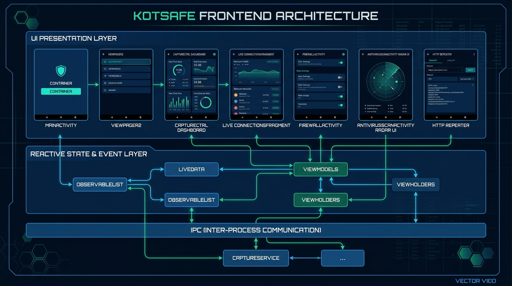

# KotSafe: Complete Frontend UI/UX Design Specification & Asset Archive

This directory contains the entire frontend design collection, design systems, visual assets, real device screenshots, and UI architecture documentation for **KotSafe**.

---

## 📁 Design Assets Index

### 1. High-Resolution Architectural & Thematic Graphics
* [`images/frontend_architecture.jpg`](images/frontend_architecture.jpg) – Full technical layer diagram showing UI presentation, reactive state, and native engine IPC.
* [`images/hero_banner.jpg`](images/hero_banner.jpg) – High-tech cybersecurity hero banner with KotSafe shield.
* [`images/firewall_nac.jpg`](images/firewall_nac.jpg) – Concept illustration of 5-way Network Access Control.
* [`images/threat_intel.jpg`](images/threat_intel.jpg) – Threat Intelligence feeds and SOC integration graphic.

---

### 2. Authentic Device Screenshots (Captured Live via ADB from `CPH2061`)
* [`images/real_navbar.png`](images/real_navbar.png) – **Slide-out Navigation Drawer** with complete 12-item menu, live firewall toggle, and branding.
* [`images/real_settings.png`](images/real_settings.png) – **System Settings (Upper Pane)** showing Private DNS, TLS Decryption, and Threat Intel APIs.
* [`images/real_settings_scrolled.png`](images/real_settings_scrolled.png) – **System Settings (Lower Pane)** showing Capture modes, PCAPng, and JSON backup.
* [`images/real_dashboard.png`](images/real_dashboard.png) – **Dashboard & Capture Control** with real-time speedometers and session counters.
* [`images/real_firewall.png`](images/real_firewall.png) – **Firewall & Network Access Control** with per-app toggles.
* [`images/real_antivirus.png`](images/real_antivirus.png) – **Antivirus Radar Scanner** with file scanning and entropy analysis.
* [`images/real_action_center.png`](images/real_action_center.png) – **Security Action Center** with rule manager and domain filters.
* [`images/real_alerts_center.png`](images/real_alerts_center.png) – **Alerts Center Console** with threat severity and incident actions.
* [`images/real_repeater.png`](images/real_repeater.png) – **HTTP Repeater Workbench** for on-device request tampering and replay.
* [`images/real_permissions.png`](images/real_permissions.png) – **Permissions Auditor** identifying dangerous runtime permissions.
* [`images/real_stats.png`](images/real_stats.png) – **Network Statistics** with protocol breakdowns and top talkers.

---

### 3. Forensic & Forensic Inspection Screens
* [`images/screen_connections.png`](images/screen_connections.png) – Real-time packet connection table with L4/L7 protocol tags.
* [`images/screen_connection_detail.png`](images/screen_connection_detail.png) – Deep socket inspection (cipher suite, TLS version, Geo-IP).
* [`images/screen_payload.png`](images/screen_payload.png) – Hex-dump and ASCII payload viewer.
* [`images/screen_browser_smartscreen.png`](images/screen_browser_smartscreen.png) – Local HTML5 block page (`127.0.0.1:8080`) rendered in mobile Chrome.
* [`images/screen_firewall_block.png`](images/screen_firewall_block.png) – Native system blocking dialog with risk rationale.
* [`images/screen_manual_block.png`](images/screen_manual_block.png) – Manual rule creator with IP/port prefill.

---

## 🎨 Design System & Visual Identity

KotSafe is built using **Material Design 3 (Material You)**, customized specifically for high-security, cyber-forensic mobile environments:

### Core Color Palette
| Token Name | Hex Value | Usage / Role |
| :--- | :---: | :--- |
| `background_dark` | `#0D1117` | Canvas background for OLED power efficiency |
| `surface_card` | `#161B22` | Card, dialog, and panel containers |
| `cyan_neon` | `#00E5FF` | Primary active accent, gauges, radar scan line |
| `emerald_safe` | `#00E676` | Allowed traffic, clean files, safe status |
| `crimson_threat` | `#FF1744` | Dropped packets, malware detections, YARA alerts |
| `amber_warning` | `#FFC107` | Suspicious entropy, untrusted certificates, ad blocks |
| `sapphire_accent` | `#0D47A1` | Secondary buttons, headers, concentric radar rings |

### Typography Guidelines
* **Standard Text**: Roboto / Material Sans (14sp Body, 16sp Title, 20sp Headline).
* **Forensics & Telemetry**: `Roboto Mono` tabular font for IP addresses (`10.215.173.1`), port numbers (`:443`), packet counts, and cryptographic SHA-256 hashes to guarantee zero layout shift during real-time streaming.

---

## 🏛️ UI Layout & Component Specifications

### 1. Navigation Architecture
* **Container**: `androidx.drawerlayout.widget.DrawerLayout` hosting:
  * Left-side slide-out drawer ([`app/src/main/res/menu/nav_items.xml`](file:///home/kali/Documents/KotSafe/app/src/main/res/menu/nav_items.xml))
  * Top `MaterialToolbar` with hamburger navigation toggle, capture badge, and overflow menu.
  * Root `ViewPager2` bound to `TabLayout` allowing horizontal swiping between:
    * `CaptureCtrl` (Status / Dashboard)
    * `ConnectionsFragment` (Real-Time Packet Stream)

### 2. Dynamic Animations & Custom Views
* **Radar Sweep**: Animated rotating gradient vector beam (`laser_sweep.xml` + `radar_concentric_circles.xml`).
* **Pulse Radar**: Radial breathing beacon (`pulse_radar.xml`) dynamically keyed to threat severity.
* **Empty State View**: `EmptyRecyclerView.java` handling smooth cross-fades between loading, empty, and active list states.
* **Inspectors**: Embedded modal dialogs for DNS-over-HTTPS wire format (`DohInspectorDialog.java`), JSON Web Tokens (`JwtInspectorDialog.java`), and Protobuf payloads (`ProtobufInspectorDialog.java`).

---

## 📖 Complete Technical Architecture Documentation
The complete multi-layer technical documentation is available in [**FRONTEND_ARCHITECTURE.md**](FRONTEND_ARCHITECTURE.md).
